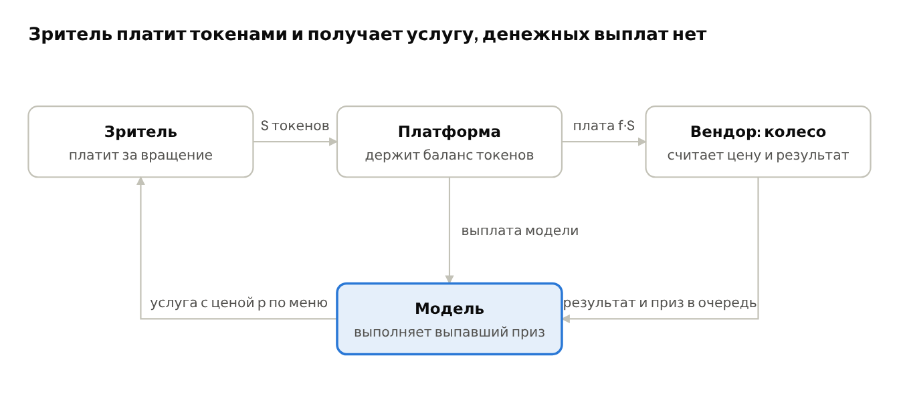
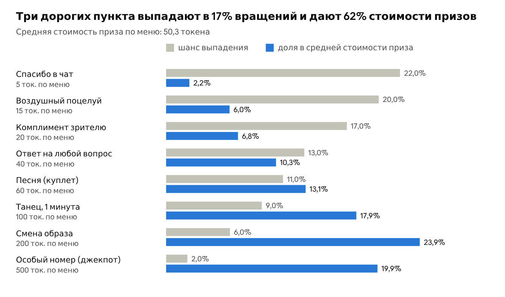
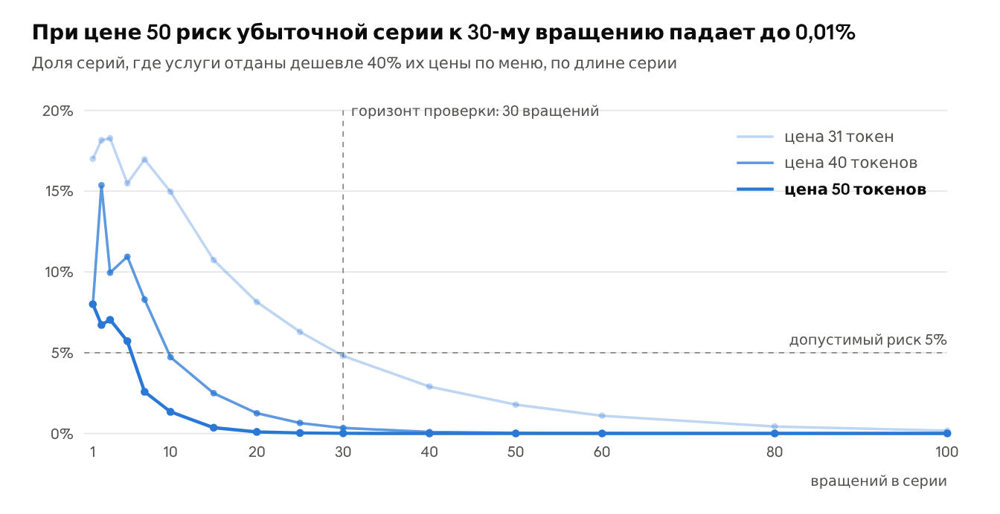
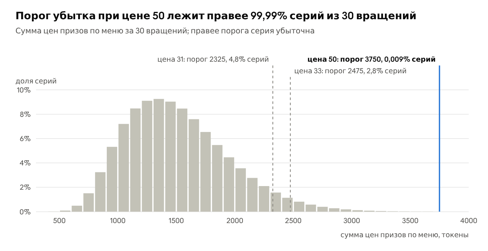
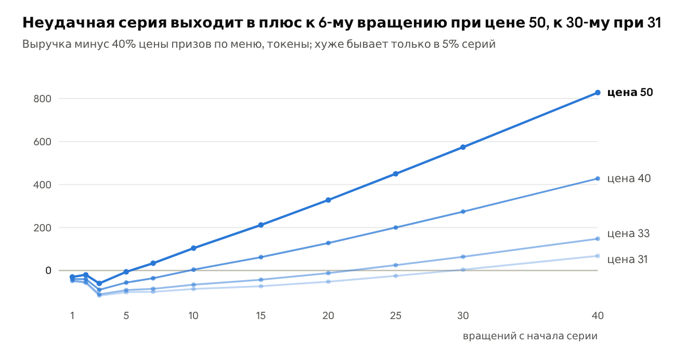
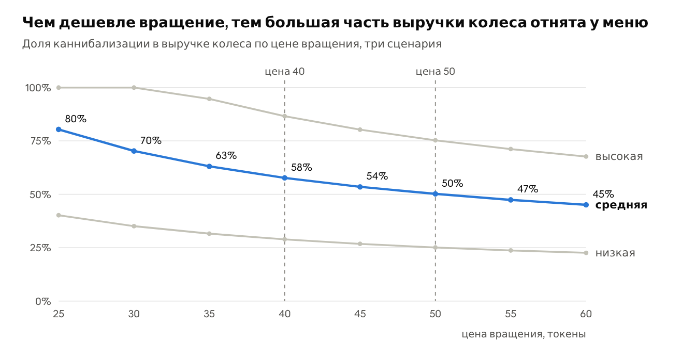
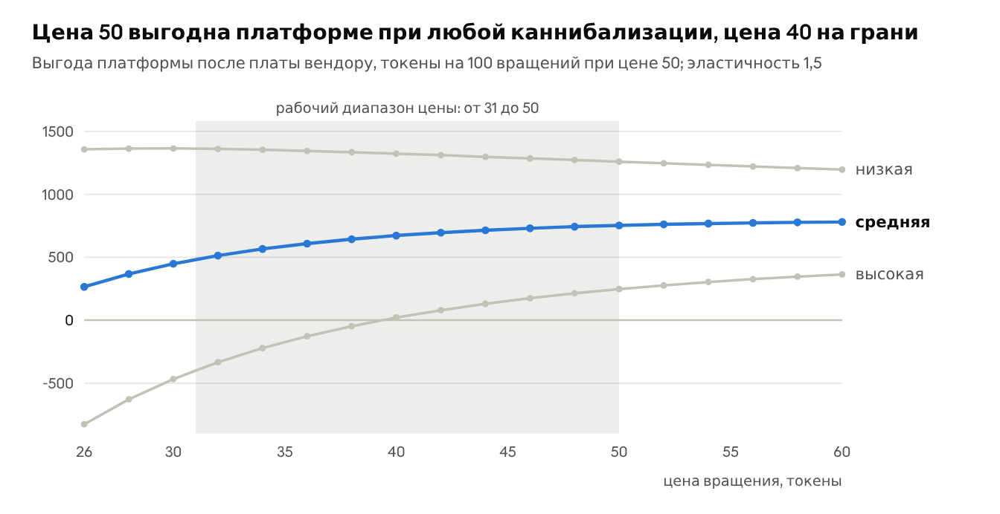
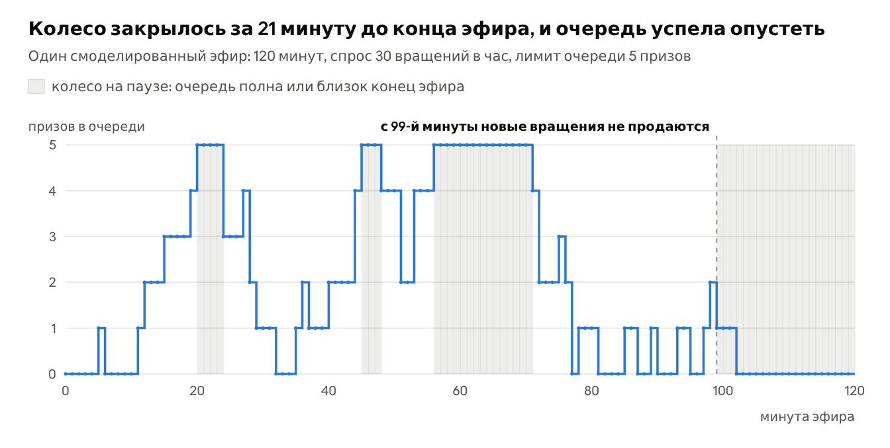
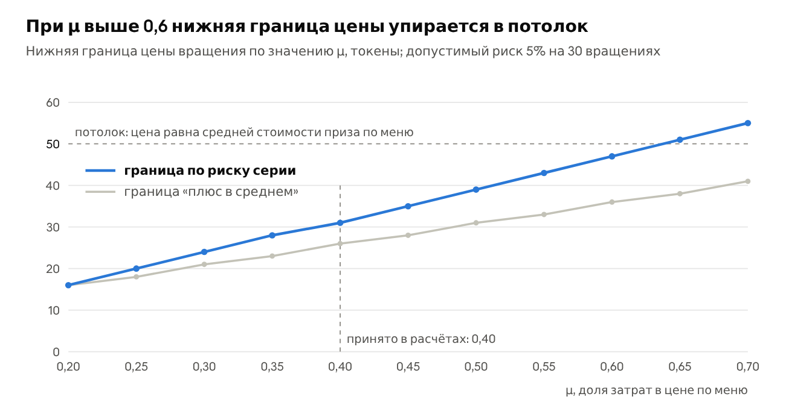

# Колесо призов: математическая модель цены вращения


## Кратко

Цена вращения задаётся как доля k от средней стоимости приза по меню модели. На меню-примере из 8 пунктов средняя стоимость приза равна 50,3 токена, нижняя граница цены 31 токен, рекомендуемая стартовая цена 50 токенов.

Документ объясняет, откуда берётся каждое число. Все расчёты сделаны на одном меню, том же, что в демо виджета.

| Вопрос | Ответ модели |
| --- | --- |
| Сколько в среднем стоит приз по меню | 50,3 токена, разброс 80,6 токена |
| Ниже какой цены опускаться нельзя | 31 токен: иначе больше 5% серий из 30 вращений убыточны |
| С какой цены стартовать | 50 токенов: прибыльна для платформы при любой рассмотренной каннибализации |
| Когда выгодна цена ниже | Только при низкой каннибализации и эластичном спросе |
| Какая скидка по акции допустима | До 38% без ограничения по количеству, глубже только купонами с бюджетом |
| Сколько призов отклоняется | Ноль по построению: вращение не продаётся, если модель не успеет выполнить приз |

Три величины модель не может вычислить сама, их измеряет пилот: две доли каннибализации и эластичность спроса по цене. До пилота оптимальная цена известна только в виде формулы и сценариев.

Открытые решения на сегодня:

- **Базовая цена.** Обсуждаются два варианта: 50 токенов (цена равна средней стоимости приза) и 40 токенов (встроенная скидка 20%). Документ считает оба.
- **Параметр μ = 0,40.** Это допущение, а не расчёт. От него зависит только нижняя граница цены и глубина акций.
- **Ставка вендора 5%.** В расчётах условная, итоговую определит пилот.

## Как читать графики и где менять параметры

Графики в этом документе показывают срезы при фиксированных параметрах из таблицы ниже. Чтобы увидеть, как картина меняется при других значениях, откройте [интерактивный калькулятор](https://claude.ai/artifact/JjF5PyTZUb4cCukm5sVK8e) (страница на claude.ai; та же страница лежит в репозитории как `calc/index.html`, её можно скачать и открыть в браузере): там все параметры вынесены в ползунки, а меню призов можно редактировать. Код калькулятора и модели лежит в папке `calc/` репозитория `devmtsarev/wheel`.

| Параметр | Значение | Комментарий |
| --- | --- | --- |
| Меню | 8 призов из демо: 5, 15, 20, 40, 60, 100, 200, 500 токенов; вероятности 22, 20, 17, 13, 11, 9, 6, 2 % | EV = 50,3; CV = 1,60 |
| μ: доля себестоимости в меню-цене | 0,40 | Предположение, задаётся клиентом-платформой |
| δ: запас над безубыточностью | 0,10 |  |
| α: допустимая вероятность убыточной серии | 5 % |  |
| N\_h: длина серии для оценки риска | 30 |  |
| σ: доля платформы в выручке | 0,40 |  |
| f: комиссия вендора | 5 % | Считается от оплаченной цены |
| ρ: требуемый ROI платформы | 3 |  |
| c0, φ: каннибализация | три сценария | Определяются пилотом |
| ε: эластичность объёма по цене | 1,5 | Определяется пилотом |
| Нагрузка на очередь модели | 0,5 |  |

Параметры со статусом «предположение» (μ, c0, φ, ε) заменяются измеренными значениями после пилота.

### Почему формулы и калькулятор не расходятся

Все расчёты выполняет один файл `model.js`. Калькулятор подключает этот же файл, а не содержит собственных копий формул. Файл покрыт 24 тестами (`model.test.js`), которые проверяют числа из этого документа: EV 50,3, CV 1,602, вероятности убытка серии из 30 вращений (4,80 % при S = 31, 2,81 % при 33, 0,34 % при 40), нижние границы цены, пороги безубыточности и оптимум. Если число в документе не совпадёт с калькулятором, тесты это покажут. Графики в документе статичные: они нарисованы по тем же формулам при значениях из таблицы.

### Соответствие разделов документа и функций модели

| Раздел документа | Функции в `model.js` |
| --- | --- |
| Меню и стоимость приза | `normalize`, `stats` |
| Что считать убытком; Риск серии | `buildTails`, `lossProb` |
| Нижняя граница цены | `riskFloor`, `avgFloor`, `menuGuard` |
| Каннибализация меню | `cannibalization` |
| Границы и оптимум цены | `breakEvenK`, `roiFloorK`, `optimumK`, `gain`, `roi` |
| Очередь модели и динамика эфира | `volume`, `capacityPrice` |
| Шанс выигрыша и верхняя граница | `winChance`, `winCeiling` |
| Итоговый коридор цен | `solve`, `evaluate` |
| Расчёт цены для любой модели; Валидатор колеса | priceForK, validate |

### Порядок внесения изменений

1. Изменить формулу в `model.js` и соответствующий тест в `model.test.js`.
2. Запустить тесты: `cd calc && node --test model.test.js`.
3. Пересобрать страницу калькулятора: `node build.js`.
4. Обновить текст и числа документа.

Этот же файл станет основой ценового сервиса на бэкенде, поэтому цена, показанная зрителю, считается по той же модели, что и в документе.

## Как устроено вращение и кто что получает

Зритель платит за вращение токенами, а получает услугу модели. Токены зрителю никто не возвращает, поэтому касса колеса не может уйти в минус.



Из этой схемы следуют три свойства, на которых стоит вся модель.

- **Выручка от вращения известна заранее.** Каждое вращение приносит ровно S токенов. Случайной величиной является только приз.
- **Случайность ложится на исполнителя.** Чем дороже выпавший приз по меню, тем больше работы модель делает за те же S токенов.
- **Убыток здесь не кассовый.** Он возникает, когда услуги отданы через колесо заметно дешевле, чем они стоят по меню.

Порядок одного вращения фиксирован, и он важен для честности.

1. Сервер проверяет допуск: лимиты зрителя, очередь модели, оставшееся время эфира.
2. Платформа списывает S токенов и подтверждает списание.
3. Только после оплаты сервер определяет результат криптостойким генератором.
4. Приз попадает в очередь модели и публикуется в чате.

Вероятности пунктов зафиксированы в версии колеса до начала вращения. После оплаты их нельзя изменить, а результат можно проверить по раскрытому seed.

Как платформа делит выручку между собой, моделью и оператором, модель цены не знает. Вендор получает долю f от уплаченной цены вращения, остальным распоряжается платформа.

## Параметры модели

Параметры делятся на три группы: то, что задано меню, то, что является решением или допущением, и то, что можно только измерить. Путать эти группы опасно: измеряемую величину нельзя «назначить».

### Задано меню модели

| Обозначение | Что это в реальности | Откуда берётся | В примере |
| --- | --- | --- | --- |
| p\_i | Цена пункта i в меню модели, токены. Столько зритель платит, заказывая услугу напрямую | Меню модели на платформе | от 5 до 500 |
| q\_i | Шанс выпадения пункта i | Настройка колеса; хранится целым числом в миллионных долях, сумма ровно 1 000 000 | от 2% до 22% |
| EV | Средняя стоимость приза по меню за одно вращение | Расчёт: сумма q\_i × p\_i | 50,3 |
| σ\_p | Разброс стоимости приза: насколько отдельное вращение отличается от среднего | Расчёт | 80,6 |
| CV | Относительный разброс, σ\_p / EV. Чем выше, тем больше колесо похоже на лотерею с джекпотом | Расчёт | 1,60 |

### Решения и допущения

| Обозначение | Что это в реальности | Кто задаёт | В примере |
| --- | --- | --- | --- |
| S | Цена одного вращения, токены | Расчёт по формулам этого документа | 31…50 |
| k | Цена вращения относительно меню, S / EV. При k = 1 зритель в среднем платит столько же, сколько стоит приз | Следует из S | 0,62…1,0 |
| d | Скидка акции или купона к базовой цене. Фриспин это d = 100% | Платформа, в пределах допустимого | 0…38% |
| μ | Во сколько обходится выполнение приза относительно его цены по меню. Порог, ниже которого услуги считаются отданными в убыток | Допущение на уровне клиента платформы | 0,40 |
| δ | Запас над μ в среднем: насколько средняя выручка должна превышать порог | Вендор, по умолчанию | 0,10 |
| α | Допустимая доля убыточных серий | Вендор, по умолчанию | 5% |
| N\_h | Длина серии, на которой проверяется риск. Примерно столько вращений модель получает за один эфир | Вендор, по умолчанию | 30 |
| f | Плата вендору, доля от уплаченной цены вращения | Договор | 5% (условно) |
| σ | Доля платформы в токенах зрителя. Нужна только для расчёта выгоды платформы, на цену не влияет | Платформа | 0,40 |
| ρ | Целевой ROI платформы: её прирост дохода, делённый на плату вендору | Платформа | 3…4 |

### Измеряется только пилотом

| Обозначение | Что это в реальности | Как измерить |
| --- | --- | --- |
| c0 | Бюджетная каннибализация: доля выручки колеса, которую зритель потратил бы на платформе в любом случае | Контрольная группа без колеса |
| φ | Сервисная каннибализация: доля выданных призов, которые зритель и так купил бы по меню | Контрольная группа плюс две цены |
| ε | Эластичность спроса: на сколько процентов растёт число вращений при снижении цены на 1% | Две или три цены вращения |
| V1 | Число вращений за период при цене, равной EV | Пилот при k = 1 |

Два обозначения легко перепутать. Буква σ без индекса означает долю платформы, σ\_p с индексом означает разброс стоимости приза. Буква α означает допустимый риск, ε означает эластичность.

## Меню-пример и стоимость приза

На меню-примере приз в среднем стоит 50,3 токена по меню. Типичное вращение даёт меньше: в 59% случаев выпадает приз не дороже 20 токенов.



Среднюю стоимость поднимают редкие дорогие пункты. Это главное свойство колеса: среднее здесь плохо описывает отдельное вращение.

### Средняя стоимость приза

Средняя стоимость приза считается как сумма цен пунктов, взвешенных их шансами.

```math
EV = \sum_{i} q_i \, p_i = 0{,}22\cdot 5 + 0{,}20\cdot 15 + \dots + 0{,}02\cdot 500 = 50{,}3
```

В реальности это ответ на вопрос: сколько зритель заплатил бы за те же услуги по меню, если бы сделал очень много вращений. Цена по меню взята потому, что это единственный объективный ценник услуги: его назначила сама модель, и зрители по нему реально покупают.

Из этого следует требование к данным. Цены пунктов в колесе должны совпадать с действующим меню, иначе EV можно завысить и получить «выгодное» колесо без реальной выгоды.

### Разброс

Разброс показывает, насколько отдельное вращение отклоняется от среднего.

```math
\sigma_p = \sqrt{\sum_i q_i\,p_i^2 - EV^2} = 80{,}6, \qquad CV = \frac{\sigma_p}{EV} = 1{,}60
```

Разброс больше самого среднего. Так бывает, когда большинство исходов дешёвые, а редкий исход очень дорогой: джекпот стоит как десять средних призов.

Относительный разброс CV нужен дальше по двум причинам. Он определяет, сколько вращений нужно, чтобы среднее «сработало», и по нему валидатор отбраковывает слишком рискованные колёса.

### Роли пунктов

- **Утешительный пункт** («Спасибо в чат», 22%). Почти не занимает время модели и держит среднюю стоимость приза низкой. Пустых секторов без приза в колесе нет: зритель всегда что-то получает.
- **Обычные пункты** (от 15 до 200 токенов). Основная масса исходов и основная работа модели.
- **Джекпот** (2% за 500 токенов). Создаёт интерес к вращению. Выпадает хотя бы раз в 18% серий из 10 вращений и в 46% серий из 30.

## Что считать убытком: параметр μ

Убыток в этой модели означает, что услуга отдана дешевле доли μ от её цены по меню p\_i. Отдельное вращение за 40 токенов при μ = 0,40 убыточно, если выпал приз дороже 100 токенов. В целом модель остаётся в плюсе, пока цена вращения выше средних затрат на приз: S > μ × EV, то есть k > μ.

### Зачем нужен μ

Призы здесь услуги, а не деньги. Токены никто не выплачивает, поэтому в кассовом смысле прибыльно любое вращение дороже нуля.

Без меры стоимости исполнения слова «защита от убытка» ничего не значат. Параметр μ задаёт эту меру: приз с ценой по меню p\_i обходится в μ × p\_i токенов.

### Плюс в среднем: условие k > μ

Отдельное вращение может оказаться убыточным, но на длинной дистанции важно среднее. Средние затраты на один приз равны μ × EV, где EV — средняя цена приза по меню. Средний результат вращения положителен, пока цена его покрывает.

```math
E\big[S - \mu\,p_i\big] = S - \mu\,EV > 0 \quad\Longleftrightarrow\quad S > \mu\,EV \quad\Longleftrightarrow\quad k = \frac{S}{EV} > \mu
```

Здесь k — цена вращения относительно средней стоимости приза по меню. При k < 1 зритель в среднем получает больше, чем платит, а 1 − k — его скидка относительно меню. Условие k > μ значит: скидка зрителю не должна съедать всю наценку меню над реальными затратами.

| Цена вращения S | k = S / EV | Скидка зрителю 1 − k | Средний результат вращения S − μ × EV |
| --- | --- | --- | --- |
| 20 | 0,40 = μ | 60% | около 0, граница |
| 40 | 0,80 | 20% | +19,9 |
| 50 | 0,99 | около 0 | +29,9 |

Условие k > μ даёт плюс только в среднем. На коротких сериях пара дорогих призов может перевесить, поэтому рабочая нижняя граница цены выше 20 токенов: её задаёт риск серии, и на нашем меню она равна 31 (раздел «Нижняя граница цены»).

### Что μ означает в реальности

Цена по меню состоит из двух частей: реальные затраты на исполнение и наценка. Затраты включают время эфира, усилия и заказы, которые модель не выполнит, пока занята призом.

Параметр μ это доля затрат в цене меню. При μ = 0,40 услуга за 100 токенов по меню «стоит» 40 токенов, и отдавать её дешевле невыгодно.

Оценить μ можно двумя способами.

- **Через время.** Время на приз, умноженное на средний доход модели за минуту эфира, делённое на цену приза по меню.
- **Через политику платформы.** Минимальная скидка от меню, которую платформа и модели готовы терпеть на постоянной основе.

Значение 0,40 в этом документе является допущением. Его задаёт клиент платформы, а раздел про чувствительность показывает, как меняются выводы при других значениях.

### Условие убытка

Одно вращение убыточно, когда выручка S меньше затрат на выпавший приз.

```math
S < \mu\, p_i \quad\Longleftrightarrow\quad p_i > \frac{S}{\mu}
```

Серия из N вращений убыточна, когда суммарная выручка меньше суммарных затрат. Здесь P\_N обозначает сумму цен по меню всех призов серии.

```math
N\,S < \mu\, P_N \quad\Longleftrightarrow\quad P_N > \frac{N\,S}{\mu}, \qquad P_N = \sum_{j=1}^{N} p_{(j)}
```

| Цена вращения | Порог S / μ | Убыточные призы | Доля убыточных вращений |
| --- | --- | --- | --- |
| 40 | 100 | смена образа, джекпот | 8% |
| 50 | 125 | смена образа, джекпот | 8% |

Отдельное убыточное вращение нормально: без дорогих призов колесо неинтересно. Защита строится на серии, где дешёвые призы перекрывают дорогие.

### Почему доля модели не входит в условие

Если модель получает долю (1 − σ) от токенов и с меню, и с колеса, её результат за вращение записывается так.

```math
\pi_m = (1-\sigma)\,S - \mu\,(1-\sigma)\,p_i = (1-\sigma)\,(S - \mu\, p_i)
```

Множитель (1 − σ) положителен и на знак не влияет. Условие убытка одинаково при любом делении выручки, поэтому доля модели убрана из расчёта цены.

### Крайние значения

| Значение μ | Что оно утверждает | Следствие для цены |
| --- | --- | --- |
| 0 | Выполнение приза ничего не стоит | Нижней границы нет, фриспины можно раздавать без лимита |
| 0,40 | Услуга стоит 40% своей цены по меню | Нижняя граница 31 токен |
| 1 | Любая скидка от меню есть убыток | Цена ниже EV недопустима |

## Риск серии

При цене 40 токенов убыточны 0,34% серий из 30 вращений, при цене 50 токенов 0,01%. Риск падает с длиной серии, потому что дешёвые призы перекрывают редкие дорогие.



Кривые неровные на коротких сериях. Там исход решают один-два дорогих приза, и вероятность меняется скачками.

### Как считается вероятность

Суммарная стоимость призов за серию складывается из N независимых вращений. Её распределение получается свёрткой: распределение одного приза D «складывается» само с собой N раз.

```math
\Pr(\text{убыток за } N) = \Pr\!\left(P_N > \frac{N\,S}{\mu}\right), \qquad P_N \sim \underbrace{D * D * \dots * D}_{N \text{ раз}}
```

Расчёт точный, а не приближённый. Цены в меню целые, поэтому распределение умещается в массив длиной 500 × N, и компьютер считает его за миллисекунды при публикации каждой версии колеса.

### Почему не хватает простой формулы

Есть быстрая оценка через нормальное распределение. Она говорит, какая цена держит риск серии на уровне α.

```math
S_{risk} \approx \mu\,EV\left(1 + z_{\alpha}\,\frac{CV}{\sqrt{N_h}}\right), \qquad z_{0{,}05} = 1{,}645
```

На нашем меню формула даёт 29,8 токена, точный расчёт даёт 31. При цене 40 нормальное приближение обещает 0,04% убыточных серий, в действительности их 0,34%.

Причина в джекпоте. Он делает правый хвост распределения тяжелее нормального, и формула занижает риск вдвое. Поэтому в продукте границу задаёт точный расчёт, а формула служит первой прикидкой.

### Распределение за 30 вращений

За 30 вращений модель в среднем выполняет призов на 1509 токенов по меню. В 5% серий сумма превышает 2315 токенов.



Одно распределение обслуживает все цены сразу. Цена вращения не меняет форму кривой, она только сдвигает порог, за которым начинается убыток.

### Как риск уходит со временем

Результат серии считается как выручка минус затраты на призы: N × S − μ × P\_N. График показывает этот результат для неудачных серий: хуже бывает только в 5% случаев.



Чем выше цена, тем раньше даже неудачная серия выходит в плюс. При цене 31 это происходит к 30-му вращению, при 40 к 10-му, при 50 к 6-му.

### Проверка симуляцией

Точный расчёт сверен с методом Монте-Карло. Миллион случайных вращений дал среднюю стоимость приза 50,15 и разброс 80,3 при расчётных 50,3 и 80,6.

| Цена вращения | Убыточных серий из 30, точный расчёт | Убыточных серий из 30, миллион симуляций |
| --- | --- | --- |
| 31 | 4,80% | 4,81% |
| 40 | 0,34% | 0,34% |
| 50 | 0,009% | 0,009% |

Расхождения укладываются в статистическую погрешность симуляции. Это подтверждает, что свёртка реализована верно.

## Нижняя граница цены

На меню-примере цена вращения не может быть ниже 31 токена. Границу задаёт самое строгое из трёх условий, и здесь это риск серии.

```math
S_{min} = \left\lceil \max\Big( (\mu + \delta)\,EV,\;\; S_{risk},\;\; \max_i q_i\,p_i \Big) \right\rceil
```

| Условие | Что оно гарантирует | Формула | На нашем меню |
| --- | --- | --- | --- |
| Плюс в среднем | Средняя выручка превышает средние затраты с запасом δ | (μ + δ) × EV | 0,5 × 50,3 = 25,2, то есть 26 |
| Риск серии | Не больше 5% серий из 30 вращений убыточны | Наименьшая S, при которой точная вероятность убытка не выше α | 31 |
| Защита меню | Нужный пункт нельзя «выудить» вращениями дешевле, чем купить по меню | максимум q\_i × p\_i | 0,06 × 200 = 12 |

### Плюс в среднем

Средний результат одного вращения равен S − μ × EV. Он положителен, когда S > μ × EV, то есть k > μ.

Запас δ нужен потому, что нулевой средний результат означает убыток примерно в половине серий. Это условие самое слабое и работает как страховка для колёс с малым разбросом.

### Риск серии

Это условие из предыдущего раздела. Сервер перебирает цены снизу вверх и останавливается на первой, при которой доля убыточных серий длиной N\_h не превышает α.

```math
S_{risk} = \min\left\{ S : \Pr\!\left(P_{N_h} > \frac{N_h\,S}{\mu}\right) \le \alpha \right\}
```

При цене 30 убыточны 6,2% серий, при цене 31 уже 4,8%. Поэтому граница равна 31.

Горизонт 30 вращений выбран как оценка числа вращений за один эфир. Смысл условия: модель не должна заканчивать в минус больше одного эфира из двадцати.

### Защита меню от «выуживания»

Зритель, которому нужен конкретный пункт, может крутить колесо, пока пункт не выпадет. В среднем ему понадобится 1 / q\_i вращений, и он заплатит S / q\_i токенов.

```math
\frac{S}{q_i} \ge p_i \;\; \text{для всех } i \quad\Longleftrightarrow\quad S \ge \max_i q_i\,p_i
```

Пока условие выполнено, покупка по меню остаётся самым дешёвым способом получить конкретную услугу. На нашем меню самый «уязвимый» пункт это смена образа: при цене 31 она обходится через колесо в 517 токенов против 200 по меню.

Условие защищает только от охоты за одним пунктом. Переток зрителей с меню на колесо в целом описывает отдельный раздел про каннибализацию.

### Верхняя граница

Верхняя граница равна EV, то есть 50 токенов. Выше неё зритель в среднем платит больше, чем стоит приз по меню.

Это ограничение принято по двум причинам. Шансы показаны в интерфейсе, и сделка дороже меню выглядит для зрителя плохо; кроме того, модель спроса не проверена за пределами этого диапазона.

## Базовая цена, скидки и фриспины

Базовая цена равна k × EV: при k = 1 это 50 токенов, при k = 0,8 это 40 токенов. Скидка по акции окупается, только если число вращений растёт быстрее, чем падает цена.

```math
S_{base} = \mathrm{round}(k \cdot EV), \qquad S_{paid} = \mathrm{round}\big(S_{base}\,(1 - d)\big)
```

Коэффициент k единственная ручка цены. Модель им не управляет: цена считается автоматически из меню и шансов.

### Два варианта базовой цены

| Показатель | Цена 40 (k = 0,8) | Цена 50 (k = 1) |
| --- | --- | --- |
| Что получает зритель в среднем | Приз на 50,3 токена по меню за 40 | Приз на 50,3 токена по меню за 50 |
| Вращений, где приз по меню не дешевле цены вращения | 41% | 28% |
| Убыточных серий из 10 вращений | 4,7% | 1,3% |
| Убыточных серий из 30 вращений | 0,34% | 0,01% |
| Переток зрителей с меню | Выше: колесо заметно дешевле меню | Ниже: колесо в среднем не дешевле меню |
| Запас под акции до нижней границы 31 | 22% | 38% |

При цене 50 зритель в 72% вращений получает приз дешевле уплаченного. Это честно, потому что шансы показаны, но конверсия может оказаться ниже, чем при цене 40.

Выбор между вариантами зависит от каннибализации и эластичности спроса. Им посвящены два следующих раздела.

### Когда скидка окупается

Без акции выручка равна V\_0 × S. Со скидкой d она равна V\_d × S × (1 − d), где V\_d обозначает число вращений во время акции.

```math
V_d\,S\,(1-d) > V_0\,S \quad\Longleftrightarrow\quad \frac{V_d}{V_0} > \frac{1}{1-d}
```

| Скидка | Уплаченная цена при базовой 50 | Нужный прирост числа вращений |
| --- | --- | --- |
| 10% | 45 | больше 11% |
| 20% | 40 | больше 25% |
| 30% | 35 | больше 43% |
| 38% | 31 | больше 61% |

Этот порог не учитывает каннибализацию. С ней сравнивается не вся выручка, а только её приростная часть.

```math
\Delta R = V_d\,S\,(1-d)\,\big(1 - c(k_d)\big) - V_0\,S\,\big(1 - c(k_0)\big), \qquad k_d = k_0\,(1-d)
```

Глубокая скидка увеличивает долю каннибализации c, поэтому реальный порог выше табличного. Платформа видит это в отчёте по каждой акции: вращения, выручка, меню-стоимость призов, фактическая скидка.

### Предел глубины скидки

Акция без ограничения по числу вращений не может опускать цену ниже S\_min. Отсюда предел скидки.

```math
d_{max} = 1 - \frac{S_{min}}{S_{base}} = 1 - \frac{31}{50} = 38\%
```

Более глубокие скидки и фриспины возможны только как купоны с бюджетом: число штук, срок действия, лимит на зрителя. Условие риска серии для них не выполняется, поэтому риск ограничивается количеством.

| Вид купона | Уплаченная цена | Средние затраты на приз, μ × EV | Средний результат вращения |
| --- | --- | --- | --- |
| Скидка 50% | 25 | 20,1 | +4,9 |
| Скидка 75% | 13 | 20,1 | −7,1 |
| Фриспин | 0 | 20,1 | −20,1 |

Фриспин стоит платформе примерно 20 токенов работы модели, или 50 токенов услуг по меню. Это и есть цена привлечения, с которой платформа сравнивает конверсию зрителя в платящего.

### Правила для акций

- **Шансы одинаковы.** Акционное и бесплатное вращение использует ту же версию колеса и те же вероятности, что платное.
- **Цена не зависит от зрителя.** Скидка привязана к акции или купону, а не к истории трат конкретного человека.
- **В журнале две цены.** Каждое вращение хранит базовую цену, уплаченную цену и идентификатор акции.
- **Плата вендору считается от уплаченной цены.** С фриспина она равна нулю; минимальная плата за вращение остаётся вопросом договора.

## Расчёт цены для любой модели

Цена вращения считается по одной формуле из меню модели и общих параметров. Числа 40 и 50 из этого документа относятся только к меню-примеру: для другого меню те же k и μ дадут другие цены.

```math
S(k) = \min\Big( \lfloor EV \rfloor,\; \max\big( S_{min},\; \mathrm{round}(k \cdot EV) \big) \Big)
```

Формула раскрывается через три величины, и каждая считается из входных данных.

```math
EV = \sum_i q_i\,p_i, \qquad S_{min} = \left\lceil \max\Big( (\mu + \delta)\,EV,\;\; S_{risk},\;\; \max_i q_i\,p_i \Big) \right\rceil, \qquad S_{risk} = \min\left\{ S : \Pr\!\left(P_{N_h} > \frac{N_h\,S}{\mu}\right) \le \alpha \right\}
```

### Что подаётся на вход

| Величина | Откуда берётся | Общая или своя у модели |
| --- | --- | --- |
| p\_i, цены пунктов | Действующее меню модели | Своя |
| q\_i, шансы пунктов | Договорённость с платформой и моделью, в пределах правил валидатора | Своя |
| k, цена относительно средней стоимости приза | Решение с платформой | Общая |
| μ, доля затрат в цене по меню | Платформа | Общая |
| δ, α, N\_h: запас, допустимый риск, длина серии | Платформа; по умолчанию 0,10, 5%, 30 | Общие |

Одинаковый k значит одинаковые условия для зрителя у всех моделей: за вращение он в среднем получает приз стоимостью 1 / k от уплаченного. Цена в токенах при этом у каждой модели своя.

### Порядок расчёта

1. Посчитать EV по меню и шансам.
2. Посчитать три нижние границы и взять наибольшую с округлением вверх: это S\_min.
3. Посчитать цену round(k × EV) и зажать её между S\_min и EV, округлённым вниз.
4. Проверить меню правилами валидатора. Если S\_min выше EV или нарушено другое правило, менять нужно шансы или состав колеса, а не цену.

Если цену пришлось поднять до S\_min, фактический k этой модели выше договорённого: скидка зрителю на её меню меньше, чем у остальных.

### Что считается вручную, а что только программой

EV, граница «плюс в среднем» и защита меню считаются на калькуляторе. У S\_risk замкнутой формулы нет: это перебор цен по точному распределению суммы призов за N\_h вращений (раздел «Риск серии»). Для прикидки в разговоре есть приближение через разброс меню.

```math
S_{risk} \approx \mu\,EV\left(1 + z_{\alpha}\,\frac{CV}{\sqrt{N_h}}\right), \qquad CV = \frac{\sigma_p}{EV}, \quad z_{0{,}05} = 1{,}645
```

Приближение неточно в обе стороны: на меню-примере оно даёт 29,8 вместо точных 31, на дорогом меню из таблицы ниже 104 вместо 108, а на меню с редким дорогим джекпотом 38 вместо 35. Рабочая цена берётся только из точного расчёта.

### Пример вручную

Меню из шести пунктов с ценами 5, 10, 15, 20, 30, 50 и шансами 25, 25, 20, 15, 10, 5%; μ = 0,40, δ = 0,10, k = 0,8.

- EV = 0,25 × 5 + 0,25 × 10 + 0,20 × 15 + 0,15 × 20 + 0,10 × 30 + 0,05 × 50 = 15,25.
- Плюс в среднем: 0,5 × 15,25 = 7,6. Риск серии, точный расчёт: 8. Защита меню: наибольшее q\_i × p\_i равно 3.
- S\_min = 8, потолок 15.
- Цена: round(0,8 × 15,25) = 12 токенов, внутри коридора от 8 до 15.

### Четыре меню, одни параметры

Параметры у всех одинаковые: μ = 0,40, δ = 0,10, α = 5%, N\_h = 30. Таблица получена пакетным скриптом из файла `menus.example.json`.

| Меню | EV | CV | S\_min | Потолок | Цена при k = 1 | Цена при k = 0,8 | Валидатор |
| --- | --- | --- | --- | --- | --- | --- | --- |
| Меню-пример | 50,3 | 1,60 | 31 | 50 | 50 | 40 | пройден |
| Дорогое меню, от 20 до 1500 | 183,0 | 1,41 | 108 | 183 | 183 | 146 | пройден |
| Дешёвое ровное меню, от 5 до 50 | 15,3 | 0,71 | 8 | 15 | 15 | 12 | пройден |
| Редкий большой джекпот: 1% за 2000 | 36,5 | 5,42 | 35 | 36 | 36 | 35, поднята до S\_min | отклонён: джекпот тяжелее 25% EV, CV выше 2,0 |

У первых трёх меню коридор широкий, и оба k дают разные цены. У четвёртого нижняя граница почти совпала с потолком: выбора цены нет, и колесо нужно пересобрать.


Коридор у каждого меню свой даже при одинаковых параметрах. Его ширину задаёт разброс призов: чем тяжелее хвост меню, тем выше S\_min относительно EV.


С ростом μ нижняя граница растёт у всех меню, но с разной скоростью. Меню-пример упирается в потолок около μ = 0,65, меню с редким джекпотом уже при 0,45. Поэтому μ нужно согласовать с платформой до расчёта цен: от него зависит, у каких моделей колесо вообще возможно.

### Пакетный расчёт

Скрипт `calc/price.js` в репозитории считает цены сразу для всех моделей. На входе один файл: общие параметры (μ, δ, α, N\_h, список k) и меню каждой модели с ценами и шансами пунктов.

```
node price.js menus.json          # таблица
node price.js menus.json --csv    # для табличного редактора
```

На выходе для каждой модели: EV, CV, S\_min и условие, которое его задало, потолок, цена для каждого k, шанс выигрыша и доля убыточных серий при этой цене, результат валидатора. Скрипт вызывает функции `priceForK` и `validate` из `model.js`, того же файла, на котором работает калькулятор.

Выбор самого k эта формула не решает: он зависит от каннибализации и спроса, которым посвящены следующие разделы.

## Каннибализация меню

Каннибализация это часть выручки колеса, которую платформа получила бы и без него. В модели её доля равна c0 + φ / k и растёт, когда вращение дешевеет.



При низкой цене в тяжёлом сценарии каннибализация достигает 100%. Тогда колесо только перекладывает деньги зрителей из меню и попутно отдаёт услуги дешевле.

### Два вида каннибализации

**Бюджетная, c0.** Зритель пришёл с бюджетом на вечер и потратил бы его в любом случае: на меню или чаевые. Часть этих токенов ушла на колесо, и от цены вращения эта часть не зависит.

**Сервисная, φ.** Зритель хотел конкретную услугу и купил бы её по меню, но получил призом. Платформа теряет продажу по полной цене меню, а взамен получает цену вращения.

Пример сервисной каннибализации: зрителю, который собирался заказать песню за 60 токенов, она выпала на колесе. При цене вращения 40 платформа недополучила 20 токенов, при цене 50 только 10.

### Откуда формула

За период сделано V вращений. Выручка колеса равна V × S, призов выдано на V × EV токенов по меню.

Потерянные продажи складываются из двух частей. Бюджетная часть пропорциональна выручке колеса, сервисная пропорциональна стоимости выданных призов.

```math
c(k) = \frac{c_0\,V S + \varphi\,V\,EV}{V S} = c_0 + \frac{\varphi}{k}
```

Прирост выручки на платформе равен выручке колеса за вычетом каннибализации.

```math
\Delta W = V S\,\big(1 - c(k)\big) = V\,EV\,\big(k\,(1 - c_0) - \varphi\big)
```

Из последней формулы виден смысл φ. Каждое вращение «стоит» платформе φ × EV потерянных продаж меню независимо от цены, поэтому у цены появляется нижняя граница выгодности.

### Сценарии

Сценарии условные. Они показывают диапазон возможного, реальные значения даст пилот.

| Сценарий | c0 | φ | Когда так бывает |
| --- | --- | --- | --- |
| Низкая | 0,10 | 0,15 | Колесо привлекает в основном тех, кто раньше не платил |
| Средняя | 0,20 | 0,30 | Смешанная аудитория: и новые платящие, и постоянные покупатели меню |
| Высокая | 0,30 | 0,45 | Колесом пользуются в основном те, кто и так покупал по меню |

### Пример с 65%

В обсуждении звучала оценка: 65% выручки колеса зрители потратили бы и без него. Одно такое число совместимо с очень разными мирами.

- **Вся каннибализация бюджетная:** c0 = 0,65, φ = 0. Цена вращения на долю каннибализации не влияет.
- **Вся сервисная, измерена при цене 40:** c0 = 0, φ = 0,65 × 0,80 ≈ 0,52. При цене 50 доля упала бы до 52%.

Различить эти случаи можно только измерением при двух разных ценах. От ответа зависит, имеет ли смысл поднимать цену ради выгоды платформы.

## Границы и оптимум цены для платформы

Цена 50 токенов выгодна платформе во всех трёх сценариях каннибализации. Цена 40 выигрывает 5% в лёгком сценарии и почти обнуляет выгоду в тяжёлом.



Риск несимметричен. Ошибка «поставили 50, а надо было 40» стоит платформе несколько процентов выгоды, обратная ошибка может оставить её почти без выгоды.

### Выгода платформы

Платформа получает долю σ от прироста выручки и платит вендору долю f от всей выручки колеса. Предполагается, что доля σ одинакова для меню и для колеса.

```math
G(k) = \sigma\,\Delta W - f\,V S = V(k)\,EV\,\Big[\,k\,\big(\sigma(1-c_0) - f\big) - \sigma\varphi\,\Big]
```

Число вращений зависит от цены. Модель берёт простейшую форму спроса с постоянной эластичностью.

```math
V(k) = V_1\,k^{-\varepsilon}
```

Эластичность ε отвечает на вопрос, на сколько процентов вырастет число вращений, если цену снизить на 1%. При ε = 1,5 снижение цены с 50 до 40 увеличивает число вращений на 40%, при ε = 0,8 только на 20%.

### Граница безубыточности

Выражение в квадратных скобках должно быть положительным. Отсюда цена, ниже которой колесо убыточно для платформы при любом спросе.

```math
G(k) > 0 \quad\Longleftrightarrow\quad k > k_{be} = \frac{\sigma\,\varphi}{\sigma\,(1-c_0) - f}
```

### Граница по ROI

ROI платформы здесь означает её прирост дохода, делённый на плату вендору. От числа вращений и эластичности он не зависит.

```math
ROI(k) = \frac{\sigma\,\big(k(1-c_0) - \varphi\big)}{f\,k} \ge \rho \quad\Longleftrightarrow\quad k \ge k_{\rho} = \frac{\sigma\,\varphi}{\sigma\,(1-c_0) - \rho f}
```

### Оптимум

Максимум G(k) находится из условия равенства нулю производной. Результат совпадает с классическим правилом наценки: цена равна «себестоимости», умноженной на ε / (ε − 1).

```math
k^{*} = \frac{\varepsilon}{\varepsilon - 1}\,k_{be} \quad \text{при } \varepsilon > 1
```

Роль себестоимости играет k\_be: это цена, при которой вращение только покрывает потерянные продажи меню и плату вендору. При ε не больше 1 спрос неэластичен, выгода растёт с ценой, и оптимум упирается в верхнюю границу.


Все три кривые пересекаются около цены 50: объём вращений нормирован на эту точку. Точная формула даёт оптимум 37,3 токена при ε = 2,5, на графике с шагом 2 токена максимум виден у 38.

### Итоговое правило цены

Оптимум зажимается между нижними границами и потолком. Здесь S\_cap обозначает цену, при которой спрос не превышает то, что модель успевает выполнить; она выводится в разделе про очередь.

```math
S^{*} = \min\Big( EV,\; \max\big( k^{*}EV,\; S_{min},\; k_{\rho}EV,\; S_{cap} \big) \Big)
```

### Сценарии на меню-примере

Расчёт сделан при σ = 0,40 и f = 5%. Цены указаны в токенах.

| Каннибализация | Безубыточность | ROI не ниже 3 | ROI не ниже 4 | ROI при цене 50 | Оптимум при ε = 1,5 | Оптимум при ε = 2,5 |
| --- | --- | --- | --- | --- | --- | --- |
| Низкая | от 10 | от 15 | от 19 | 6,0 | 31 (нижняя граница) | 31 (нижняя граница) |
| Средняя | от 23 | от 36 | от 51, выше потолка | 4,0 | 50 (потолок) | 37 |
| Высокая | от 40 | недостижим | недостижим | 2,0 | 50 (потолок) | 50 (потолок) |

В лёгком сценарии формула даёт оптимум ниже границы риска (29 и 16 токенов), поэтому цена встаёт на 31. В тяжёлом сценарии платформа в плюсе только от 40 токенов, а ROI выше 2 недостижим в рабочем диапазоне.

### Предел применимости

Даже при цене, равной меню, колесо окупается не всегда. Подстановка k = 1 в условие ROI даёт предел на суммарную каннибализацию.

```math
c_0 + \varphi \le 1 - \frac{\rho\,f}{\sigma}
```

| Цель платформы | Допустимая каннибализация при цене, равной меню |
| --- | --- |
| Безубыточность | не выше 87,5% |
| ROI не ниже 3 | не выше 62,5% |
| ROI не ниже 4 | не выше 50% |

Если измеренная каннибализация выше предела, ценой это не исправить. Остаётся снижать ставку вендора f или менять само колесо: состав призов, которых нет в меню, снижает φ.

## Конфликт интересов и схема оплаты

При оплате процентом от выручки колеса вендору выгодна более низкая цена, чем платформе. При ε = 1,5 цена 40 даёт вендору на 12% больше, чем цена 50, а платформе в среднем сценарии на 11% меньше.

### Откуда конфликт

Выручка колеса равна числу вращений, умноженному на цену. При эластичном спросе она растёт, когда цена падает.

```math
W(k) = V_1\,EV\,k^{\,1-\varepsilon}, \qquad \frac{W(40)}{W(50)} = \left(\frac{50}{40}\right)^{\varepsilon - 1}
```

Платформа же считает не выручку колеса, а прирост за вычетом каннибализации. Дешёвое вращение увеличивает выручку колеса и одновременно долю каннибализации в ней.

| Эластичность ε | Выручка колеса и плата вендору: цена 40 к цене 50 | Выгода платформы, средний сценарий: цена 40 к цене 50 |
| --- | --- | --- |
| 0,8 | −4% | −24% |
| 1,5 | +12% | −11% |
| 2,5 | +40% | +12% |

Интересы совпадают только на краях: при неэластичном спросе обоим выгодна высокая цена, при очень эластичном обоим выгодна низкая. В середине вендор зарабатывает на том, что платформе вредит.

Это существенно, потому что цену считает алгоритм вендора. Платформа должна быть уверена, что алгоритм не занижает цену ради оборота.

### Два способа снять конфликт

**Закрепить целевую функцию.** В договоре записано, что алгоритм максимизирует выгоду платформы G(k), а не выручку колеса. Параметры c0, φ и ε берутся из пилота и пересматриваются раз в квартал.

**Платить долей от прироста.** Вендор получает долю s от прироста дохода платформы. Тогда обе стороны максимизируют одну и ту же величину, и оптимумы совпадают автоматически.

```math
\text{плата вендору} = s\,\sigma\,\Delta W, \qquad G_A = (1-s)\,\sigma\,\Delta W, \qquad k^{*}_A = \frac{\varepsilon}{\varepsilon-1}\cdot\frac{\varphi}{1-c_0}
```

При такой схеме ROI платформы равен 1 / s при любой цене: при s = 25% это 4.

### Варианты договора

| Вариант | Как считается плата | Стимулы вендора | Что нужно для работы |
| --- | --- | --- | --- |
| A: доля от прироста | s × прирост дохода платформы, измеренный по контрольной группе | Совпадают со стимулами платформы | Постоянная контрольная группа, доступ к данным по меню и чаевым |
| B: процент от выручки | f × выручка колеса, где f = s × σ × (1 − c) по итогам пилота | Вендору выгоден оборот, нужна закреплённая целевая функция | Пилот и пересчёт f раз в квартал |

Пример из обсуждения для варианта B: при каннибализации 65%, доле платформы 40% и s = 25% ставка равна 0,25 × 0,40 × 0,35 = 3,5% от выручки колеса. Ставка 5% в расчётах этого документа соответствует каннибализации 50%.

## Очередь модели и динамика эфира

Вращение продаётся только тогда, когда модель гарантированно успеет выполнить любой приз. В симуляции двухчасового эфира при спросе 30 вращений в час продаётся 37 вращений из 60 желающих, а невыполненных призов нет.



Паузы в середине эфира возникают, когда в очереди уже пять призов. Самая длинная из них длится с 56-й по 70-ю минуту: очередь всё это время остаётся полной.

### Правило допуска

Перед списанием токенов сервер проверяет два условия. В очереди есть место, и времени эфира хватит на всю очередь плюс самый долгий приз колеса.

```math
L < L_{max} \quad \text{и} \quad T_{queue} + T_{worst} + T_{buf} \le T_{left}
```

| Величина | Что это |
| --- | --- |
| L, L\_max | Число призов в очереди и его лимит |
| T\_queue | Время, нужное модели на уже выигранные призы |
| T\_worst | Время на самый долгий пункт колеса |
| T\_buf | Запас на переходы между призами |
| T\_left | Время до конца эфира, которое сообщает платформа или сама модель |

В проверке стоит самый долгий приз, потому что результат до вращения неизвестен. Подбирать приз под остаток времени нельзя: это было бы скрытое изменение вероятностей.

Из правила следует, что доля отклонённых призов равна нулю по построению. Обрыв связи и другие форс-мажоры остаются исключением и решаются на стороне платформы.

### Допущения симуляции

- **Длительности призов:** спасибо и поцелуй по 10 секунд, комплимент 20, ответ на вопрос 60, песня 90, танец 60, смена образа 300, джекпот 600. В среднем 61 секунда на вращение.
- **Время модели:** половина эфира уходит на призы колеса, половина на всё остальное. Отсюда ёмкость около 30 вращений в час.
- **Ограничения:** лимит очереди 5 призов, запас 60 секунд, эфир 120 минут.
- **Спрос:** желающие приходят случайно с постоянной средней частотой; получивший отказ не возвращается.

Длительности взяты условно. В продукте их задаёт модель для каждого пункта колеса.

### Сколько вращений проходит при разном спросе

Средние по 200 смоделированным эфирам на каждый уровень спроса.

| Спрос, вращений в час | Желающих за эфир | Продано | Отказ: очередь полна | Отказ: близок конец эфира | Колесо на паузе, доля времени |
| --- | --- | --- | --- | --- | --- |
| 12 | 24 | 19 | 0,4 | 5 | 21% |
| 24 | 48 | 33 | 5 | 10 | 32% |
| 36 | 72 | 41 | 14 | 17 | 43% |
| 60 | 120 | 47 | 42 | 31 | 61% |

Во всех прогонах очередь к концу эфира пуста. Правило допуска выполняет свою задачу, но платит за это отказами.

### Цена правила худшего случая

Джекпот занимает 10 минут работы, или 20 минут эфира при половинной загрузке. Поэтому колесо закрывается минимум за 21 минуту до конца эфира, даже если очередь пуста.

При низком спросе это главная потеря: пять отказов из 24 желающих. Уменьшить её можно двумя способами, не трогая вероятности внутри версии колеса.

- **Финальное колесо.** За полчаса до конца включается отдельная версия без долгих призов, со своими опубликованными шансами и своей ценой. Зритель видит смену версии.
- **Перенос долгих призов.** Приз, на который не хватило времени, переносится на следующий эфир. Это решение платформы, потому что оно создаёт долг перед зрителем.

### Цена, при которой спрос равен ёмкости

Если желающих больше, чем модель успевает обслужить, часть спроса пропадает в отказах. Выгоднее поднять цену до уровня, при котором спрос сравняется с ёмкостью V\_cap.

```math
V_1\,k^{-\varepsilon} \le V_{cap} \quad\Longleftrightarrow\quad k \ge k_{cap} = \left(\frac{V_1}{V_{cap}}\right)^{1/\varepsilon}
```

Пример: при цене 40 желающих 40 в час, модель успевает 30. При ε = 1,5 спрос сравняется с ёмкостью при цене 48 токенов.

### Динамическая цена

Динамическая подстройка меняет только цену и только между вращениями. Вероятности заморожены в версии колеса.

- **Ступени.** Цена принимает одно из заранее объявленных значений между S\_min и EV, например 31, 36, 40, 45, 50.
- **Сигнал.** Шаг вверх, когда очередь заполнена на 60% дольше двух минут; шаг вниз, когда она ниже 20% дольше десяти. Не чаще одного шага за пять минут.
- **Фиксация для зрителя.** Показанная цена действует 30 секунд. Если она успела смениться, списание происходит только после повторного согласия.
- **Без персонализации.** Цена одинакова для всех зрителей комнаты и не зависит от их трат и истории.

При базовой цене 50 двигаться можно только вверх, выше меню. Поэтому в этом варианте динамика по умолчанию выключена, и единственным рычагом перегрузки остаётся пауза.

## Валидатор колеса

Версия колеса не публикуется, если нарушено хотя бы одно из шести правил. Правила нужны потому, что нижняя граница цены защищает только от риска при данном колесе, а само колесо тоже бывает плохим.

| Правило | Порог | Зачем оно |
| --- | --- | --- |
| Сумма шансов | Ровно 1 000 000 миллионных долей | Показанные зрителю шансы должны совпадать с реальными без округлений |
| Утешительные пункты | Суммарный шанс не меньше 20% | Держат низкими среднюю стоимость приза и нагрузку на модель |
| Доля джекпотов в EV | Не больше 25% | Иначе результат эфира зависит от одного-двух исходов |
| Относительный разброс CV | Не больше 2,0 | Ограничивает общий разброс, от которого зависит нижняя граница цены |
| Существование цены | S\_min не больше EV | Иначе нет цены, которая и безопасна, и не дороже меню |
| Цены пунктов | Совпадают с действующим меню модели | Иначе EV можно завысить и искусственно поднять цену вращения |

Пороги в таблице являются значениями по умолчанию. Клиент платформы может ужесточить их, но не ослабить.

### Пример отклонённого колеса

Возьмём наше меню и утроим шанс джекпота: 6% вместо 2%, за счёт пункта «Спасибо в чат».

| Показатель | Исходное колесо | Джекпот 6% | Правило |
| --- | --- | --- | --- |
| Средняя стоимость приза | 50,3 | 70,1 | не ограничена |
| Шанс утешительных пунктов | 22% | 18% | нарушено: меньше 20% |
| Доля джекпота в EV | 19,9% | 42,8% | нарушено: больше 25% |
| Относительный разброс CV | 1,60 | 1,69 | выполнено |

Колесо отклонено по двум правилам, хотя общий разброс почти не вырос. Поэтому одного правила про CV недостаточно: оно не видит, что почти половина стоимости призов сидит в одном пункте.

## Чувствительность к параметрам

Сильнее всего на выводы влияют каннибализация и параметр μ. При μ = 0,40 нижняя граница цены равна 31 токену, при μ = 0,60 уже 47, почти у потолка.



Каждые 0,05 к μ добавляют к нижней границе около 4 токенов. Граница по риску всегда строже границы «плюс в среднем», потому что разброс на этом меню велик.

### Что значит μ для акций

При базовой цене 50 параметр μ определяет только глубину допустимой скидки.

| μ | Нижняя граница цены | Максимальная скидка акции от цены 50 |
| --- | --- | --- |
| 0,30 | 24 | 52% |
| 0,40 | 31 | 38% |
| 0,50 | 39 | 22% |
| 0,60 | 47 | 6% |

Поэтому при цене 50 клиенту можно не показывать μ. Достаточно одного понятного параметра «максимальная скидка акции», а μ остаётся внутренней величиной.

### Допустимый риск и горизонт

Чем строже требование к риску и короче горизонт, тем выше нижняя граница.

| Допустимая доля убыточных серий | Длина серии | Нижняя граница цены |
| --- | --- | --- |
| 2% | 30 | 35 |
| 5% | 30 | 31 |
| 5% | 50 | 29 |
| 5% | 100 | 26 |

Модель с длинными эфирами и большим числом вращений может позволить себе более низкую цену. Для начинающей модели с десятком вращений за эфир граница должна быть выше.

### Ставка вендора и доля платформы

Эти параметры не влияют на нижнюю границу по риску, но сдвигают границы выгодности для платформы. Расчёт для среднего сценария каннибализации.

| Что меняем | Значение | Безубыточность платформы, цена от | ROI не ниже 3, цена от |
| --- | --- | --- | --- |
| Ставка вендора f | 3% | 21 | 27 |
| Ставка вендора f | 5% | 23 | 36 |
| Ставка вендора f | 8% | 26 | 76, выше потолка |
| Доля платформы σ | 0,30 | 24 | 51, выше потолка |
| Доля платформы σ | 0,50 | 22 | 31 |

Безубыточность почти не зависит от этих параметров, а целевой ROI зависит сильно. При ставке 8% платформа не получит ROI 3 ни при какой допустимой цене.

### Что важнее всего

1. **Каннибализация, c0 и φ.** Определяет, выгодно ли колесо платформе вообще. Измеряется только пилотом.
2. **Эластичность ε.** Определяет, где внутри диапазона лежит оптимум. Измеряется только пилотом.
3. **Параметр μ.** Определяет нижнюю границу и глубину акций. Задаётся клиентом платформы.
4. **Ставка f и доля σ.** Определяют достижимый ROI. Задаются договором.
5. **Риск α и горизонт N\_h.** Сдвигают нижнюю границу на несколько токенов.

## Задача оптимизации: цели, ограничения, неизвестные

Цена вращения выбирается как решение задачи с одной целью и набором ограничений. Сегодня известны все ограничения, которые зависят от меню, и неизвестны пять величин, которые зависят от поведения зрителей и модели.

### Почему одна цель, а не несколько

Интересы участников конфликтуют: платформе нужен прирост дохода, модели нужна посильная нагрузка, зрителю нужна честная сделка. Свести их в одну формулу с весами нельзя без произвольных весов.

Поэтому одна величина максимизируется, а остальные становятся ограничениями. Максимизируется выгода платформы G, потому что платформа решает, оставлять ли колесо.

```math
\max_{S}\; G(S) \quad \text{при условии} \quad S_{lo} \le S \le S_{hi}
```

```math
S_{lo} = \max\Big( \max_i q_i p_i,\;\; (\mu+\delta)\,EV,\;\; S_{risk}(\mu),\;\; k_{\rho}\,EV,\;\; S_{cap} \Big), \qquad S_{hi} = \min\Big( EV,\;\; S_{w}(w_{min}) \Big)
```

Если нижняя граница оказалась выше верхней, подходящей цены нет. Тогда меняется само колесо: состав пунктов, шансы или лимиты очереди.

### Ограничения

| Ограничение | Чей интерес защищает | Формула | Значение на меню-примере | От каких неизвестных зависит |
| --- | --- | --- | --- | --- |
| Защита меню | Платформа | S не меньше максимума q\_i × p\_i | от 12 | ни от каких |
| Плюс в среднем | Модель | S не меньше (μ + δ) × EV | от 26 при μ = 0,40 | μ |
| Риск серии | Модель | S не меньше S\_risk(μ), на этом меню примерно 78 × μ | от 31 при μ = 0,40 | μ |
| ROI платформы | Платформа | S не меньше σφ × EV / (σ(1 − c0) − ρf) | от 15 до недостижимого, по сценариям | c0, φ |
| Ёмкость модели | Модель | S не меньше EV × (V1 / V\_cap)^(1/ε) | неизвестно | ε, V1, V\_cap |
| Не дороже меню | Зритель | S не больше EV | до 50 | ни от каких |
| Шанс выигрыша | Зритель | w(S) не меньше w\_min | до 40 при w\_min = 40% | w\_min |
| Очередь | Модель | Правило допуска к вращению | лимит 5 призов | V\_cap |
| Лимиты трат | Зритель | Потолок трат на сессию и сутки | задаёт платформа | ни от каких |

Два ограничения не зависят ни от чего неизвестного: цена всегда лежит между 12 и 50 токенами. Всё остальное сужает этот коридор.

### Шанс выигрыша

Шанс выигрыша w здесь означает долю вращений, в которых приз по меню стоит не меньше цены вращения. Он зависит только от цены и состава колеса и меняется ступенями.

```math
w(S) = \sum_{i:\; p_i \ge S} q_i
```

| Цена вращения | Шанс выигрыша w |
| --- | --- |
| от 21 до 40 | 41% |
| от 41 до 60 | 28% |
| от 61 до 100 | 17% |

Внутри ступени шанс не меняется, поэтому цена 40 даёт зрителю тот же шанс выигрыша, что и любая цена от 21 до 39. Естественные кандидаты на цену лежат на верхнем краю ступеней: 40 и 50.

Гипотеза о том, что существует предпочтительный уровень w, проверяется пилотом. Сейчас w\_min неизвестен, и в расчёты он входит как ограничение сверху на цену.

У этого рычага есть жёсткие рамки. Шанс задаётся при публикации версии колеса и показан зрителю. Фактическая частота выигрышей у конкретного зрителя колеблется случайно, и подстраивать под неё цену или шансы нельзя: это была бы скрытая манипуляция и персонализация.

### Очередь и нечувствительный спрос

Цена регулирует очередь только при эластичном спросе. Если зрителям почти всё равно, сколько стоит вращение, формула цены по ёмкости даёт цену выше потолка.

При ε = 0,5 и спросе вдвое выше ёмкости цену пришлось бы поднять в 4 раза. Поэтому при слабой эластичности очередь регулируют прямые лимиты: размер очереди, пауза колеса, интервал между вращениями одного зрителя.

Открытый вопрос к платформе: что принято делать при переполнении обычных заказов из меню. Колесо должно встраиваться в ту же практику, а не вводить свою.

### Неизвестные величины

| Величина | Что это | На что влияет | Как узнать |
| --- | --- | --- | --- |
| ε и V1 | Чувствительность спроса к цене и его уровень | Оптимум цены; может ли цена регулировать очередь | Пилот с двумя или тремя ценами |
| c0 и φ | Каннибализация меню | Выгодно ли колесо платформе и с какой цены | Контрольная группа без колеса |
| μ | Доля затрат в цене меню | Нижняя граница цены и глубина акций | Задаёт клиент; уточняется по времени исполнения призов |
| w\_min | Шанс выигрыша, ниже которого зрители перестают играть | Верхняя граница цены | Пилот: сравнение цен по разные стороны ступени |
| V\_cap | Сколько вращений в час модель успевает выполнить | Лимиты очереди и цена по ёмкости | Фактическое время исполнения из панели модели |

Ставка вендора f и доля платформы σ тоже не зафиксированы, но это предмет договора, а не измерения.

### Как разделить эффекты в пилоте

Сравнение цен 50 и 40 меняет сразу и цену, и шанс выигрыша, поэтому эффекты смешиваются. Разделить их позволяют цены у края ступени.

- **Цены 34 и 40:** шанс выигрыша одинаковый, 41%. Разница в спросе показывает чистую чувствительность к цене, то есть ε.
- **Цены 40 и 41:** цена почти одинаковая, шанс выигрыша падает с 41% до 28%. Разница в спросе показывает чувствительность к шансу выигрыша.

### Решение до пилота

Пока неизвестные не измерены, выбирается цена, которая не проваливается ни в одном сценарии. При μ = 0,40 коридор равен 31–50, а два разумных старта дают края ступеней.

| Стартовая цена | Шанс выигрыша | Сильная сторона | Слабая сторона |
| --- | --- | --- | --- |
| 50 | 28% | Выгодна платформе при любой каннибализации | Низкий шанс выигрыша может снизить спрос |
| 40 | 41% | Шанс выигрыша в полтора раза выше, чем при цене 50 | При высокой каннибализации выгода платформы около нуля |

## Что должен измерить пилот

Пилот должен дать три числа: c0, φ и ε. Для этого нужны контрольная группа без колеса и как минимум две цены вращения, например 50 и 40.

### Схема

| Группа | Что видит зритель | Что измеряем |
| --- | --- | --- |
| Контроль | Колеса нет | Средние траты зрителя на меню и чаевые |
| Цена A | Колесо по 50 токенов | Все траты зрителя, выручка колеса, число вращений |
| Цена B | Колесо по 40 токенов | То же самое |

Разбивать нужно по комнатам или по дням, а не по зрителям внутри одной комнаты. Цена должна быть одинаковой для всех зрителей комнаты, иначе нарушается правило «без персонализации», а разницу видно в общем чате.

Модели сильно различаются по доходу, поэтому сравнение «комната против комнаты» шумное. Надёжнее чередовать режимы по дням у одних и тех же моделей и вести пилот не меньше четырёх недель.

### Как из измерений получить параметры

Доля каннибализации при данной цене считается из разницы трат между группой с колесом и контролем. Здесь R обозначает все траты зрителя на платформе, W выручку колеса на зрителя.

```math
c(k) = 1 - \frac{R_{test}(k) - R_{control}}{W(k)}
```

Две цены дают два значения c. Из них находятся оба параметра каннибализации, потому что c линейно зависит от 1 / k.

```math
\varphi = \frac{c(k_B) - c(k_A)}{1/k_B - 1/k_A}, \qquad c_0 = c(k_A) - \frac{\varphi}{k_A}
```

Эластичность находится из отношения числа вращений при двух ценах.

```math
\varepsilon = -\,\frac{\ln\big(V(k_B)/V(k_A)\big)}{\ln\big(k_B/k_A\big)}
```

### Пример расчёта

Допустим, пилот показал такие числа. Они выдуманы для иллюстрации и соответствуют среднему сценарию.

| Измерение | Цена 50 | Цена 40 |
| --- | --- | --- |
| k = цена / EV | 0,994 | 0,795 |
| Доля каннибализации c | 50,2% | 57,7% |
| Вращений на 1000 зрителей | 100 | 140 |

Из формул получается φ = 0,30, c0 = 0,20 и ε = 1,5. Подстановка в правило цены даёт оптимум выше потолка, то есть цену 50.

### Зачем третья цена

Две цены дают параметры, но не проверяют саму модель. Третья цена показывает, лежат ли три точки c на одной прямой по 1 / k и постоянна ли эластичность.

Если точки не ложатся на прямую, формула оптимума неточна. Тогда оптимум выбирается прямым сравнением измеренной выгоды платформы при трёх ценах.

### Условия, без которых пилот не работает

- **Данные о тратах вне колеса.** Без покупок меню и чаевых по группам каннибализацию посчитать нельзя.
- **Право вендора вести контрольную группу.** Часть комнат или дней остаётся без колеса на всё время измерения.
- **Неизменная экспозиция.** Платформа не продвигает и не прячет колесо в обход теста.
- **Доверительные интервалы.** Параметр c считается как отношение разностей и шумит. Цену стоит снижать, только если весь интервал для оптимума лежит ниже текущей цены.

## Допущения и ограничения модели

Модель точна в той части, которая зависит только от меню и шансов: средняя стоимость приза, риск серии, нижняя граница цены. Всё, что касается поведения зрителей, пока остаётся схемой с условными числами.

| Допущение | Что будет, если оно неверно | Как проверить или смягчить |
| --- | --- | --- |
| Вращения независимы, генератор честный | Расчёт риска серии неверен | Журнал аудита и проверка распределения исходов по истории вращений |
| μ одинаков для всех пунктов | Дешёвые пункты на деле почти бесплатны, долгие дороже; риск может быть занижен или завышен | Задать затраты для каждого пункта отдельно; формулы не меняются |
| Эластичность постоянна | Оптимум смещён | Верить формуле только в диапазоне цен, проверенных пилотом |
| c0 и φ не зависят от цены | При дешёвом вращении состав играющих меняется, и каннибализация другая | Третья цена в пилоте |
| Доля платформы одинакова для меню и колеса | Формула выгоды платформы неточна | Подставить две разные доли; структура выводов сохраняется |
| Спрос не меняется со временем | Эффект новизны завышает первые недели | Пилот не короче четырёх недель, пересчёт раз в квартал |
| Длительности призов и доля времени модели известны | Ёмкость и отказы в симуляции эфира другие | Собрать фактическое время исполнения из панели модели |

Что в модель не входит вовсе:

- **Лимиты трат зрителя.** Они ограничивают число вращений сверху и в формуле спроса не учтены.
- **Чаевые как отдельный поток.** Их вытеснение спрятано внутри c0.
- **Различия между зрителями.** Модель описывает среднего зрителя, а не сегменты.
- **Юридическая оценка.** Механика «платишь и получаешь случайный приз» в ряде стран регулируется как азартная игра или лутбокс. Это проверяет клиент платформы со своим юристом.

Все сценарии каннибализации, значения эластичности, ставка вендора 5% и доля платформы 40% в этом документе условные. Они показывают, как устроена зависимость, а не предсказывают результат конкретной платформы.

## Приложение: вывод формул

Здесь собраны выкладки, которые в основном тексте даны без вывода. Все формулы проверены численно на меню-примере.

### Среднее и разброс суммы

Вращения независимы, поэтому средние и дисперсии складываются.

```math
E[P_N] = N\,EV, \qquad \mathrm{Var}[P_N] = N\,\sigma_p^2, \qquad \sigma[P_N] = \sigma_p\sqrt{N}
```

Относительный разброс суммы равен CV / √N. За 30 вращений он падает с 1,60 до 0,29: поэтому серия предсказуемее одного вращения.

### Точное распределение суммы

Пусть D(x) обозначает вероятность того, что приз стоит x токенов. Распределение суммы строится по шагам, по одному вращению за шаг.

```math
D_1 = D, \qquad D_N(x) = \sum_{y} D_{N-1}(x - y)\,D(y)
```

Вероятность убытка равна сумме D\_N(x) по всем x больше N × S / μ.

### Быстрая оценка границы по риску

Если заменить распределение суммы нормальным с теми же средним и разбросом, условие риска решается в явном виде.

```math
\Pr\!\left(P_N > \frac{N S}{\mu}\right) \approx 1 - \Phi\!\left(\frac{N S/\mu - N\,EV}{\sigma_p\sqrt{N}}\right) = \alpha
```

```math
\frac{N S/\mu - N\,EV}{\sigma_p\sqrt{N}} = z_\alpha \quad\Longrightarrow\quad S = \mu\,EV\left(1 + z_\alpha\,\frac{CV}{\sqrt{N}}\right)
```

На меню-примере это 0,4 × 50,3 × (1 + 1,645 × 1,60 / 5,48) = 29,8. Точный расчёт даёт 31, потому что настоящий хвост тяжелее нормального.

### Защита меню

Число вращений до первого выпадения пункта i имеет геометрическое распределение со средним 1 / q\_i. Ожидаемые траты на «выуживание» равны S / q\_i.

```math
\frac{S}{q_i} \ge p_i \;\;\forall i \quad\Longleftrightarrow\quad S \ge \max_i\, q_i\,p_i
```

### Оптимум цены для платформы

Обозначим постоянные буквами a и b, чтобы не тащить их через выкладки.

```math
G(k) = V_1 EV\;k^{-\varepsilon}\,(a\,k - b), \qquad a = \sigma(1-c_0) - f, \qquad b = \sigma\varphi
```

Производная по k после вынесения общего множителя:

```math
G'(k) = V_1 EV\;k^{-\varepsilon-1}\,\big[(1-\varepsilon)\,a\,k + \varepsilon\,b\big]
```

При ε > 1 выражение в скобках положительно при малых k и отрицательно при больших. Значит, нуль производной даёт максимум.

```math
(1-\varepsilon)\,a\,k^{*} + \varepsilon\,b = 0 \quad\Longrightarrow\quad k^{*} = \frac{\varepsilon}{\varepsilon-1}\cdot\frac{b}{a} = \frac{\varepsilon}{\varepsilon-1}\,k_{be}
```

При ε не больше 1 скобка положительна при любом k, выгода растёт с ценой, и оптимум лежит на верхней границе. Формула сверена с численным поиском максимума в трёх сценариях и совпала до третьего знака.

### Граница по ROI

Прирост дохода платформы равен σ × V × EV × (k(1 − c0) − φ), плата вендору равна f × V × EV × k. Число вращений и EV сокращаются.

```math
\frac{\sigma\,\big(k(1-c_0) - \varphi\big)}{f\,k} \ge \rho \;\Longleftrightarrow\; k\,\big(\sigma(1-c_0) - \rho f\big) \ge \sigma\varphi \;\Longleftrightarrow\; k \ge \frac{\sigma\varphi}{\sigma(1-c_0) - \rho f}
```

Если знаменатель не положителен, целевой ROI недостижим ни при какой цене.

### Порядок расчёта при публикации колеса

1. По меню и шансам посчитать EV, разброс и CV.
2. Проверить правила валидатора; при нарушении вернуть ошибку с названием правила.
3. Свёрткой найти нижнюю границу по риску и взять максимум из трёх условий: получается S\_min.
4. До пилота поставить базовую цену, равную EV. После пилота посчитать границы выгодности и оптимум по измеренным c0, φ и ε.
5. По статистике очереди посчитать цену, при которой спрос равен ёмкости модели.
6. Зажать оптимум между нижними границами и потолком EV.
7. Записать неизменяемую версию колеса: пункты, шансы, цена, ступени цены и хэш конфигурации.
