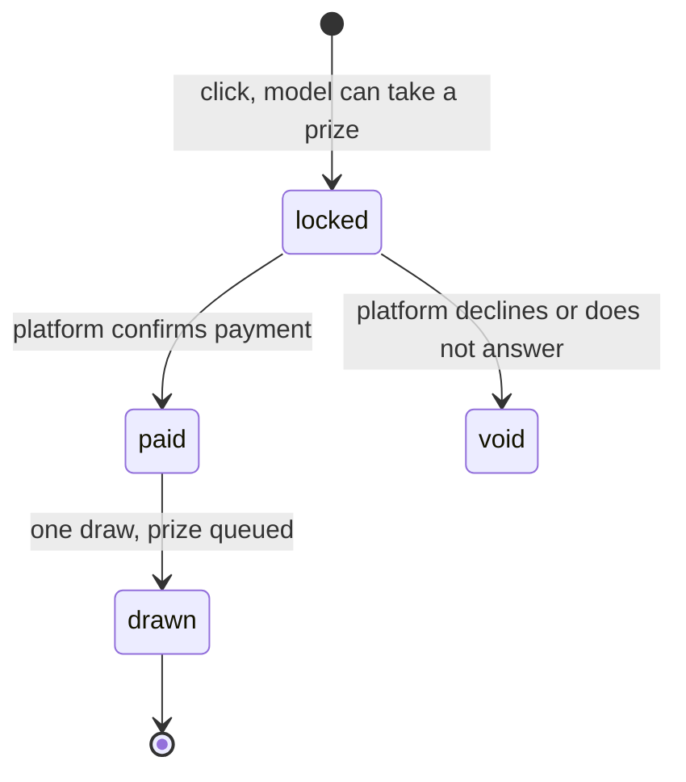

Goal: pay for one spin and receive a fairly drawn prize.
Trigger: viewer presses "Spin" in the widget.
Pre: model is live; wheel version active.
Post: platform took payment once; prize in the model's queue (UC-10); result verifiable (UC-02).

Rule: the vendor never sees the viewer's balance, limits or promotions. Whether and how much the viewer pays is decided by the platform; the vendor only locks the price, draws and records.



## Main
1. Widget shows the wheel: prizes, chances, spin price, and whether spins are available now. [tested: GET /wheels/{id}/public, T:141]
2. Viewer presses "Spin". [tested: POST /spins, T:48]
3. Vendor checks the model can take one more prize (queue, time left), locks the price and commits to a draw seed (its hash is returned). [tested: admission.js, T:48]
4. Vendor asks the platform to take payment at the locked price. [tested: webhook charge.reserve, T:48]
5. Platform applies its own rules (balance, limits, promotions), takes payment and confirms with the amount actually paid. [tested: POST /spins/{id}/commit, T:48 | gap: paid amount is computed by the vendor from a promo code, not sent by the platform (G11)]
6. Vendor draws the result once, puts the prize in the model's queue and reports the result to the platform. [tested: fair.js, T:48, T:69]
7. Widget shows the result. [server: WebSocket push spin.result]

## Alternatives
- A1 (from step 3) Price changed since it was shown: vendor returns the new price; widget asks the viewer to confirm; continue at step 2. [tested: T:141 | gap: G9]
- A2 (from step 5) Platform charges less (discount, free spin): platform confirms with the lower amount; vendor records it without checks. [gap: G11; today the vendor validates promo codes and S_min, T:159]
- A3 (from step 7) Viewer's connection drops: on reconnect the widget fetches the spin and shows the result. [spec: GET /spins/{id}]
- A4 (from step 2) Repeated click or retried request: one spin, one payment. [tested: Idempotency-Key, T:82]

## Exceptions
- E1 (from step 3) Model cannot take another prize (queue full, stream ending, wheel off): no spin, no payment; widget shows "wheel paused". [tested: T:107, T:130]
- E2 (from step 5) Platform declines payment, for any reason: spin voided; widget shows the platform's message, or a neutral "Spin not available" if there is none. [tested: T:89 | gap: platform's message is not passed through (G6)]
- E3 (from step 5) Platform does not confirm in time: spin voided, nothing charged; widget shows "try again". [server: 5 s timeout on charge.reserve, 60 s expiry before commit]

## Acceptance
```gherkin
Feature: UC-01 Spin the wheel

@UC-01 @main @tested
Scenario: Main. Spin and receive a prize
  Given the model is live and the wheel is active
  When the viewer presses "Spin"
  And the platform confirms payment
  Then the server draws exactly one result
  And the prize enters the model's queue
  And the widget shows the result

@UC-01 @A1 @tested
Scenario: A1. Price changed since it was shown
  Given the widget shows price 50 and the price is now 55
  When the viewer presses "Spin"
  Then no payment is requested
  And the widget shows 55 and asks for confirmation

@UC-01 @A2 @gap
Scenario: A2. Platform charges less
  Given the spin price is 50
  When the platform confirms payment with amount 0
  Then the spin is drawn
  And the recorded paid amount is 0

@UC-01 @A3 @server
Scenario: A3. Connection drops after payment
  Given the platform confirmed payment and the viewer lost connection
  When the widget reconnects
  Then the widget shows the result of that spin

@UC-01 @A4 @tested
Scenario: A4. Repeated request
  Given the viewer pressed "Spin" and the request was sent twice with the same key
  Then one spin exists
  And the platform is asked for payment once

@UC-01 @E1 @tested
Scenario: E1. Model cannot take another prize
  Given the model's queue is full
  When the viewer presses "Spin"
  Then no payment is requested
  And the widget shows "wheel paused"

@UC-01 @E2 @gap
Scenario: E2. Platform declines payment
  Given the platform declines with message "Not enough tokens"
  When the viewer presses "Spin"
  Then no spin is drawn
  And the widget shows "Not enough tokens"

@UC-01 @E3 @server
Scenario: E3. Platform does not confirm in time
  Given payment was requested
  And the platform does not confirm within the time limit
  Then the spin is voided
  And nothing is drawn
```
