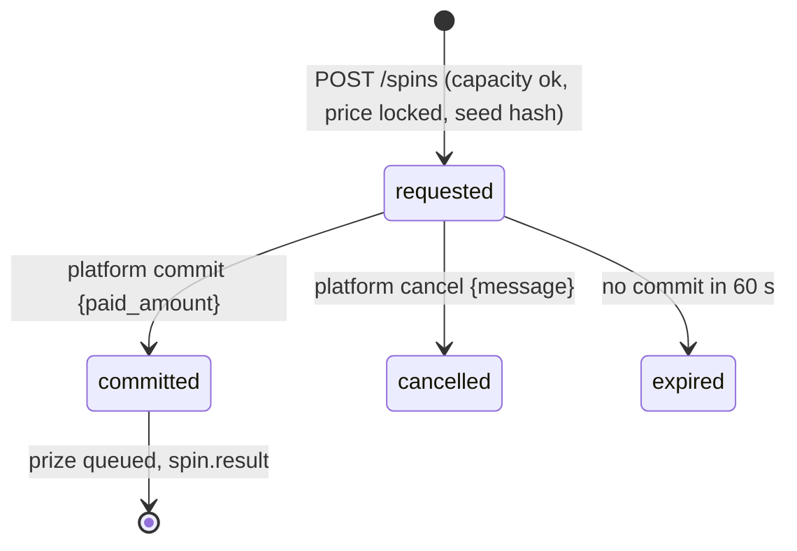

Goal: pay for one spin and receive a fairly drawn prize.
Trigger: viewer presses "Spin" in the widget.
Pre: model is live; wheel version active; widget holds a valid `widget_token`.
Post: platform charged once, by its own rules; prize in the model's queue (UC-10); result verifiable (UC-02).

Rule: the vendor never sees the viewer's balance, limits or promotions and never asks for money. It checks model capacity, locks the price, notifies the platform and waits for the platform to confirm the amount it charged.



## Main
1. Widget shows the wheel: prizes, chances, spin price, and whether spins are available now. [tested: GET /wheels/{id}/public, T:170]
2. Viewer presses "Spin"; widget sends the spin request with its viewer token. [tested: POST /spins, T:48, T:170]
3. Vendor checks the model can take one more prize and the price has not changed, locks the price, commits to a draw seed and returns its hash; widget shows "waiting for payment". [tested: admission.js, T:48]
4. Vendor notifies the platform: viewer X requested a spin at price P. It does not wait for an answer. [tested: webhook spin.requested, T:48]
5. Platform applies its rules (balance, limits, promotions), charges its wallet and confirms with the amount actually paid. [tested: POST /spins/{id}/commit {paid_amount}, T:48]
6. Vendor draws once, records the paid amount, puts the prize in the model's queue and reports the result to the platform. [tested: fair.js, T:48, T:75]
7. Widget shows the result. [server: WS spin.result]

## Alternatives
- A1 (from step 3) Price changed since it was shown: vendor returns 409 `price_changed` with the new price; widget asks the viewer to confirm; continue at step 2. [tested: T:170 | gap: G9]
- A2 (from step 5) Platform charges less (discount, free spin): confirms with the lower amount, 0 included; vendor records it without checks. [tested: T:123]
- A3 (from step 7) Viewer's connection drops: on reconnect the widget fetches the spin and shows the result. [spec: GET /spins/{id}]
- A4 (from step 2) Repeated click: one spin. [gap: G15, widget requests carry no idempotency key; platform calls do, T:88]

## Exceptions
- E1 (from step 3) Model cannot take another prize (queue full, stream ending, wheel off): no spin; widget shows "wheel paused". [tested: T:136, T:159]
- E2 (from step 5) Platform declines, for any reason: it cancels the spin with a message; the widget shows that message as is. Nothing is drawn. [tested: T:103 | server: WS spin.cancelled]
- E3 (from step 5) Platform does not confirm within 60 s: spin expires, platform receives `spin.expired`; a late confirm gets 409 `spin_expired`. If the platform had already charged, it refunds on its side. [tested: T:114]

## Acceptance
```gherkin
Feature: UC-01 Spin the wheel

@UC-01 @main @tested
Scenario: Main. Spin and receive a prize
  Given the model is live and the wheel is active
  When the viewer presses "Spin"
  Then the platform is notified with the locked price and the seed hash
  When the platform confirms with paid amount 50
  Then the server draws exactly one result
  And the spin records paid amount 50
  And the prize enters the model's queue
  And the widget shows the result

@UC-01 @A1 @tested
Scenario: A1. Price changed since it was shown
  Given the widget shows price 50 and the price is now 55
  When the viewer presses "Spin"
  Then no spin is created
  And the widget shows 55 and asks for confirmation

@UC-01 @A2 @tested
Scenario: A2. Platform charges less
  Given a requested spin at price 50
  When the platform confirms with paid amount 0
  Then the spin is drawn
  And the recorded paid amount is 0

@UC-01 @A3 @server
Scenario: A3. Connection drops after payment
  Given the platform confirmed the spin and the viewer lost connection
  When the widget reconnects
  Then the widget shows the result of that spin

@UC-01 @A4 @gap
Scenario: A4. Repeated click
  Given the widget sent the same spin request twice with the same key
  Then one spin exists
  And the platform is notified once

@UC-01 @E1 @tested
Scenario: E1. Model cannot take another prize
  Given the model's queue is full
  When the viewer presses "Spin"
  Then no spin is created
  And the widget shows "wheel paused"

@UC-01 @E2 @tested
Scenario: E2. Platform declines
  Given a requested spin
  When the platform cancels it with message "Not enough tokens"
  Then no result is drawn
  And the widget shows "Not enough tokens"

@UC-01 @E3 @tested
Scenario: E3. Platform does not confirm in time
  Given a requested spin whose confirmation deadline has passed
  When the platform confirms it
  Then the answer is 409 spin_expired
  And nothing is drawn
  And the platform has received spin.expired
```
