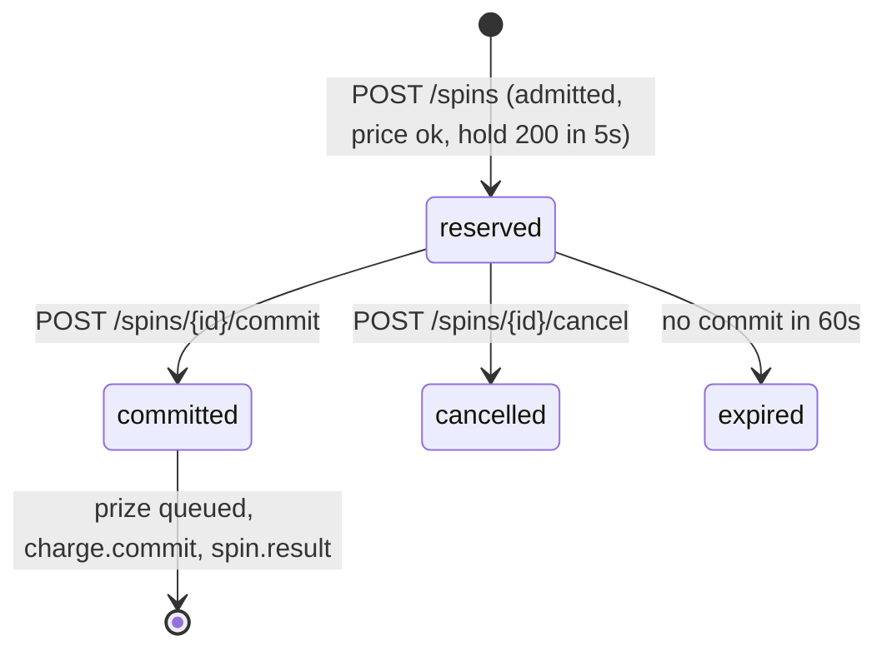

Goal: pay for one spin and receive a fairly drawn prize.
Trigger: viewer presses "Spin" in the widget.
Pre: model is live; wheel version active; widget holds a valid `widget_token`.
Post: tokens charged once; prize in the model's queue (UC-10); result verifiable (UC-02).



## Main
1. Platform issues `widget_token` (JWT ≤15 min: wheel_id, viewer_id). [tested: T:141]
2. Widget shows items (menu price, ppm), spin price valid 30 s, win chance, `content_hash`, paused flag. [tested: GET /wheels/{id}/public]
3. Viewer presses Spin; widget sends `POST /spins` {client_seed, shown_price, Idempotency-Key}. [tested: T:48]
4. Server checks admission and price, sends `charge.reserve`; platform holds tokens, answers 200 within 5 s. [tested: admission.js, T:48]
5. Spin `reserved`; widget receives `server_seed_hash`; hold lives 60 s. [tested: T:48]
6. Platform confirms payment: `POST /spins/{id}/commit`. [tested: T:48]
7. Server draws once (HMAC-SHA256(server_seed, client_seed:nonce) → 0..999999 → item by cumulative ppm), queues prize, sends `charge.commit` + `spin.result`, reveals `server_seed`. [tested: fair.js, T:69]
8. Widget gets WS `spin.result`, plays animation; all stream viewers get `spin.created`. [server: app.js broadcast]

## Alternatives
- A1 @3 price changed: `shown_price` ≠ current → 409 `price_changed` {price}; viewer confirms → step 3. Note: README promises 30 s validity, server compares with current price only; no check if `shown_price` absent (G9). [tested: T:141]
- A2 @3 promo code: `paid_price = round(price × (1 − d))`, ≥ S_min; free spin = 0 → step 4. [tested: T:159]
- A3 @3,6 repeated request: same `Idempotency-Key` returns first result, no re-execution. [tested: T:82]
- A4 @8 connection lost after payment: widget reconnects with backoff, reads `GET /spins/{id}`, shows result. [spec: api/README WebSocket]

## Exceptions
- E1 @3 wheel paused (queue_full | stream_ending | wheel_inactive): 409 {reason, retry_after_s}; widget shows "wheel paused"; nothing held. [tested: T:107, T:130]
- E2 @4 not enough tokens: platform refuses hold → 502 `reserve_failed`, same as timeout; viewer sees "try again", not "top up". `reserve_failed` not in stable error codes (G6). [tested: T:89 | gap: G6]
- E3 @3 promo invalid (expired, exhausted, other model, below S_min): 409 `promo_invalid`. [tested: T:159]
- E4 @5-6 viewer cancels or no commit in 60 s: `cancelled|expired` → `charge.release`; promo counter returned. [tested: T:97 | server: expiry timer]
- E5 @3 spending limit reached: not implemented (G13). [gap]

## Acceptance
```gherkin
Feature: UC-01 Spin the wheel

@UC-01 @main @tested
Scenario: Spin and receive a prize
  Given the model is live and the wheel is active
  And the viewer has at least the spin price in tokens
  When the viewer presses "Spin" at the shown price
  Then the platform holds the spin price
  And after the platform commits, the server draws exactly one result
  And the platform charges the held tokens once
  And the prize enters the model's queue
  And the widget shows the result with a verifiable seed

@UC-01 @A1 @tested
Scenario: Price changed while shown
  Given the widget shows price 50 and the price has stepped to 55
  When the viewer presses "Spin"
  Then no tokens are held
  And the widget shows 55 and asks for confirmation

@UC-01 @A1 @gap
Scenario: Shown price honoured for 30 seconds
  Given the widget showed price 50 twenty seconds ago and the price is now 55
  When the viewer presses "Spin" with shown_price 50
  Then the spin is reserved at 50

@UC-01 @E1 @tested
Scenario: Queue full
  Given the model's queue has reached its limit
  When the viewer presses "Spin"
  Then no tokens are held
  And the response is 409 with reason "queue_full" and a retry time

@UC-01 @E2 @gap
Scenario: Not enough tokens
  Given the viewer has 20 tokens and the spin price is 50
  When the viewer presses "Spin"
  Then no spin is created
  And the error code is "insufficient_funds"
  And the widget offers to top up the balance

@UC-01 @E4 @tested
Scenario: Viewer cancels before the draw
  Given a spin is reserved
  When the viewer cancels it
  Then the platform receives charge.release for the held amount

@UC-01 @E4 @server
Scenario: Hold expires
  Given a spin is reserved
  And the platform does not commit within 60 seconds
  Then the spin becomes expired
  And the platform receives charge.release for the held amount
```
