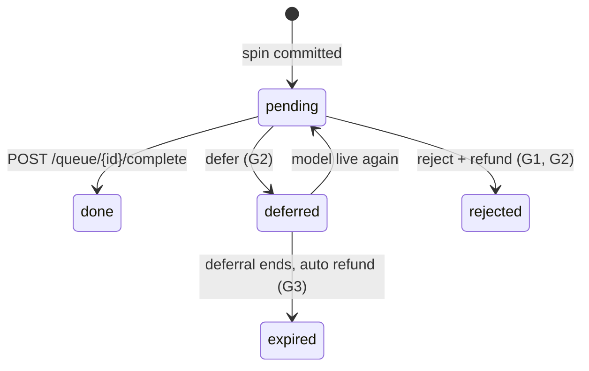

Goal: perform every won prize during the stream it was won in.
Trigger: a prize enters the model's queue.
Pre: model is live; stream state reported (UC-12).
Post: prize `done`; queue slot free; sales resume if paused for a full queue.

Rule: a drawn spin is never undone. Problems after the draw become a prize status and, if money returns, a refund event (UC-06).


Only `pending` and `done` exist today.

## Main
1. Prize joins the queue in order; `spin.result` appears in the stream chat. [tested: T:48]
2. Platform shows the queue to the model on its stream screen from `GET /models/{id}/queue`. [server; the screen is the platform's]
3. Model performs the prize on stream. [outside the system]
4. Operator marks it done: `POST /queue/{id}/complete`; slot freed; audit `queue.done`. Who marks is open (Q1). [tested: T:121]

## Alternatives
- A1 (from step 3) out of order: any queued item can be marked done. [server]
- A2 (from step 3) deferred to the next stream: with the viewer's consent the prize becomes `deferred` with an expiry and returns to `pending` when the model is next live. [gap: G2]

## Exceptions
- E1 (from step 3) model refuses (viewer left, abusive, item removed): operator rejects with a reason → `rejected` + refund (UC-06). [gap: G1, G2; prototype refunds on reject]
- E2 (from step 3) stream ends early: every `pending` prize becomes `deferred` with an expiry; on expiry → `expired` + refund. Today prizes stay `pending` forever and occupy the queue. [gap: G3]
- E3 (from step 4) viewer disputes "done": UC-07. [gap]

Admission (UC-12) prevents E2 at the planned end only if `duration_s` is accurate; real durations not yet received from the platform.

## Acceptance
```gherkin
Feature: UC-10 Fulfil a prize

@UC-10 @main @tested
Scenario: Fulfilling frees the queue
  Given the queue limit is 5 and the queue is full
  When the operator marks one prize done
  Then the queue has 4 prizes
  And new spins are sold again

@UC-10 @E2 @gap
Scenario: Stream ends with pending prizes
  Given two prizes are pending
  When the platform reports the stream as ended
  Then both prizes become deferred with an expiry date
  And both viewers are notified
  When the expiry date passes without fulfilment
  Then each prize becomes expired
  And each viewer is refunded the original paid price

@UC-10 @E1 @gap
Scenario: Model refuses
  Given a pending prize
  When the operator rejects it with reason "viewer left"
  Then the prize becomes rejected
  And the spin is refunded once
```
