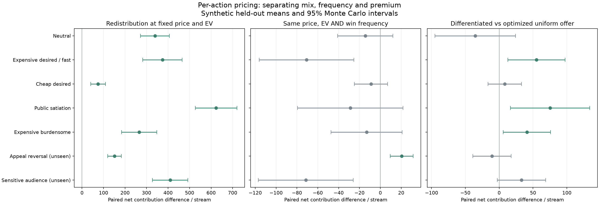
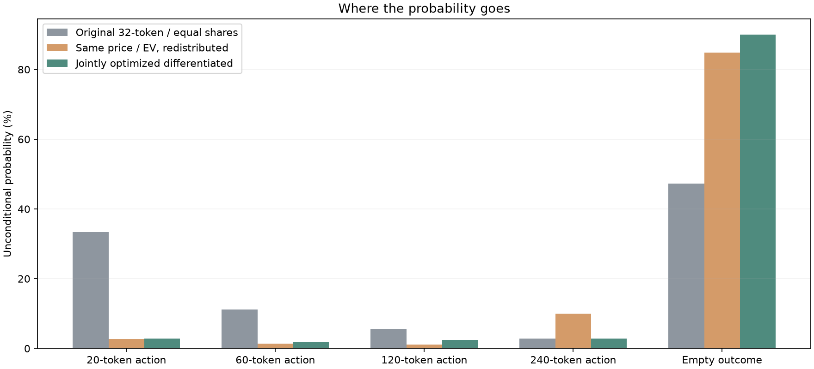

# Per-action adjustment results

Synthetic net contribution per observed stream, in token-equivalents. Same populations and decision shocks are paired across policies; these are not live revenue forecasts. These worlds and seeds differ from the earlier joint-pricing study.

18,060 training policy-stream evaluations (including no-wheel references); 4,900 held-out evaluations. Five training worlds, two unseen worlds, 100 evaluation seeds per world/policy. All 35 experiment tests pass.

## Selected offers

| Policy | Shape | Spin price | Total win rate | Aggregate premium | Action adjustments, prices 20 / 60 / 120 / 240 |
|---|---|---:|---:|---:|---|
| Matched price/EV | expensive_concentrated | 32.00 | 15.1% | 20% | +1400.0% / +900.0% / +500.0% / -66.7% |
| Uniform joint | equal | 22.74 | 5.0% | 800% | +800.0% / +800.0% / +800.0% / +800.0% |
| Differentiated joint | expensive | 57.14 | 10.0% | 400% | +2400.0% / +1150.0% / +400.0% / +108.3% |
| Adaptive: lower pressure | expensive | 57.14 | 10.0% | 400% | +2400.0% / +1150.0% / +400.0% / +108.3% |
| Adaptive: higher pressure | middle | 29.19 | 5.0% | 800% | +2150.0% / +462.5% / +462.5% / +2150.0% |

Adaptive threshold: 1.5. The fixed differentiated offer selected with negative adjustments allowed is arm 168; with all adjustments constrained nonnegative it is arm 168.

## 1. Redistribute at the same price and expected reward value

Both offers charge 32 tokens and award 26.67 tokens of expected direct-purchase value. The selected redistribution puts 90% of expected reward value into the 240-token action. Its adjustment is −66.7% relative to the explicit equal reference allocation. Total win frequency changes: this comparison controls price and EV, not frequency.

| Audience | Equal-share reference | Selected redistribution | Paired difference [95% MC interval] |
|---|---:|---:|---|
| neutral | 1204 | 1543 | +339 [+272, +406] |
| expensive_desired_fast | 3231 | 3605 | +374 [+283, +466] |
| cheap_desired | 688 | 762 | +75 [+41, +109] |
| public_satiation | 1780 | 2404 | +623 [+527, +720] |
| expensive_burdensome | 1244 | 1510 | +266 [+184, +348] |
| appeal_reversal_unseen | 595 | 746 | +151 [+119, +183] |
| value_and_odds_sensitive_unseen | 3231 | 3640 | +410 [+327, +492] |

### Additional control: same price, EV and total win frequency

Exploratory, pre-specified shapes within this follow-up check; neither is selected using its evaluation results. The expensive-action control uses value shares [.31,.03,.25,.41], giving the 240-token action a -26.8% adjustment. The middle-action control uses [.29,.05,.41,.25], discounting the 120-token action. Both retain price 32, EV 26.67 and total win frequency 52.78%. This removes the slower-win-frequency explanation, but still includes service-cost and public-action effects.

| Audience | Expensive-action control vs equal shares [95% MC] | Middle-action control vs equal shares [95% MC] |
|---|---|---|
| neutral | -14 [-41, +12] | -19 [-45, +6] |
| expensive_desired_fast | -71 [-116, -25] | -39 [-82, +3] |
| cheap_desired | -9 [-25, +7] | -3 [-19, +12] |
| public_satiation | -29 [-79, +22] | -16 [-64, +31] |
| expensive_burdensome | -13 [-47, +21] | -5 [-36, +26] |
| appeal_reversal_unseen | +21 [+10, +31] | +4 [-11, +19] |
| value_and_odds_sensitive_unseen | -71 [-117, -26] | -34 [-77, +9] |

These 2,100 additional evaluations share the same 100 evaluation seeds. Intervals are exploratory and unadjusted for multiple comparisons; this is not a third independent sample.

## 2. Optimize the mix and aggregate premium together

| Audience | No wheel | Uniform joint | Differentiated joint | Adaptive differentiated | Differentiated minus uniform [95% MC interval] |
|---|---:|---:|---:|---:|---|
| neutral | 1288 | 1627 | 1591 | 1609 | -35 [-95, +24] |
| expensive_desired_fast | 3672 | 3834 | 3889 | 3890 | +55 [+13, +97] |
| cheap_desired | 663 | 839 | 848 | 860 | +8 [-16, +33] |
| public_satiation | 2279 | 2531 | 2606 | 2569 | +75 [+17, +134] |
| expensive_burdensome | 1351 | 1525 | 1566 | 1583 | +41 [+6, +76] |
| appeal_reversal_unseen | 547 | 740 | 730 | 743 | -11 [-39, +18] |
| value_and_odds_sensitive_unseen | 3672 | 3740 | 3773 | 3769 | +33 [-3, +69] |

The unrestricted joint optimum is identical to the optimum with all per-action adjustments nonnegative. Permitting negative adjustments therefore adds **no measured gain in the selected joint policy** in this search. The matched-price/EV result supports redistribution that includes a discount, not a claim that discounts are globally necessary.

## Demand, supply, and cannibalization

| Audience | Selected fixed: spin attempts / accepted | Completion rate | Direct receipts vs uniform | 240-token direct receipts vs uniform | 240-token wheel awards | Assigned workload, seconds |
|---|---:|---:|---:|---:|---:|---:|
| neutral | 45.8 / 5.7 | 100% | -67 | -72 | 0.1 | 566 |
| expensive_desired_fast | 45.7 / 5.3 | 100% | -29 | -34 | 0.1 | 588 |
| cheap_desired | 20.7 / 3.9 | 100% | -15 | +10 | 0.1 | 344 |
| public_satiation | 52.3 / 7.1 | 100% | -43 | -46 | 0.2 | 1010 |
| expensive_burdensome | 47.9 / 4.9 | 74% | -19 | -34 | 0.1 | 952 |
| appeal_reversal_unseen | 21.8 / 3.9 | 100% | -33 | -10 | 0.1 | 410 |
| value_and_odds_sensitive_unseen | 22.4 / 2.4 | 100% | +0 | -2 | 0.1 | 588 |

Assigned workload includes every awarded obligation, including unfinished awards. Attempted demand is measured before capacity refusals. Direct-receipt differences are paired policy effects, not a claim that every wheel buyer would otherwise buy directly.

## Interpretation and boundaries

- The matched-frequency expensive-action control loses in the expensive-desired and more-sensitive worlds with intervals below zero. Most other differences include zero; appeal reversal is the positive exception. The large initial redistribution gain cannot be attributed to desirability or negative adjustments alone.
- Different action adjustments can help, but the globally trained differentiated policy does not beat a strong uniform policy in every audience. Read the paired intervals rather than just point estimates.
- Negative adjustment is defined relative to a fixed 1/4 reference allocation. It is not the expected total spend to obtain that action, and it is not negative accounting margin. Value shares do not allocate actual receipts.
- Expensive actions receive lower adjustments in the selected joint policy. That is consistent with the hypothesis, but does not establish a universal price-demand relationship.
- Empty outcomes, all award obligations, finite budgets and the 24-action quota remain. Incomplete streams stay in return means.
- Model coefficients, price/odds response, future retention and reputation remain uncalibrated. The finite grid and 12-seed training selection can overfit. No live pricing or existing website demo is changed.

See [model, equations and reproduction](../ACTION_MODEL.md). `action-demand-surface.csv` contains all training offer/world combinations with per-action demand and supply measurements; `action-summary.csv` contains full held-out means and paired net intervals.
