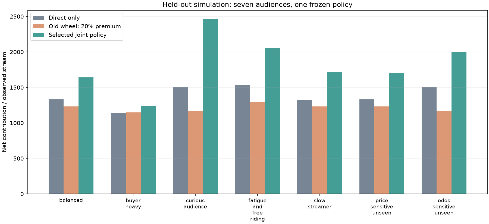
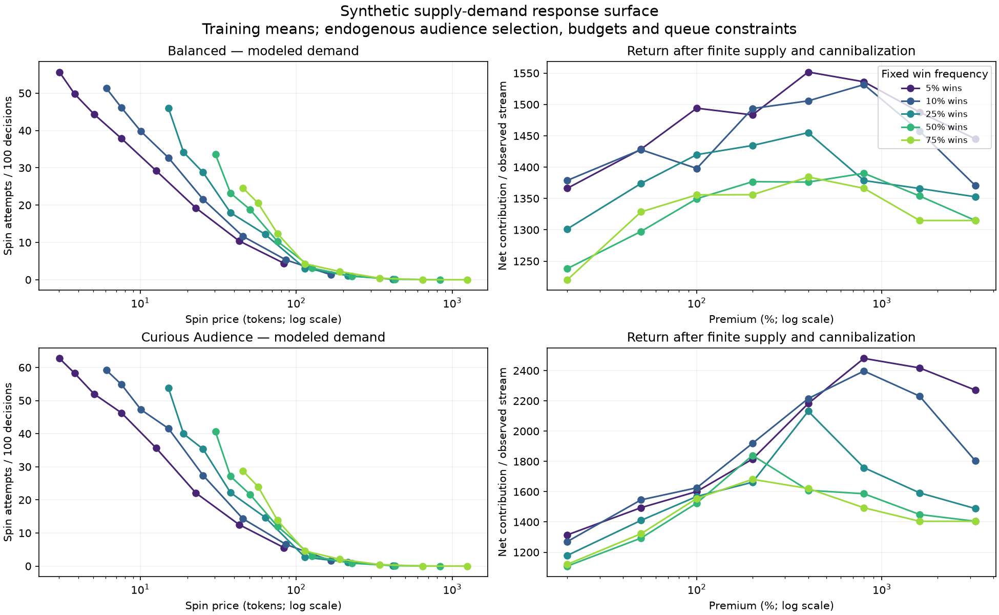

# Joint premium and supply-demand results

All figures are synthetic scenario outcomes, not forecasts. Net contribution is per observed stream in token-equivalents. No live behavior changed.

Training: 20 seeds × five audiences × 41 fixed offers and 60 switching policies = 10,100 candidate streams, plus no-wheel references. Evaluation: 100 seeds × seven audiences × four policies = 2,800 recorded streams.

## Frozen global policies

- Best fixed: arm 27: 22.74 tokens, 800% premium, 5% wins.
- Selected adaptive candidate: below pressure 0.75: arm 28: 45.47 tokens, 800% premium, 10% wins; otherwise arm 22: 12.63 tokens, 400% premium, 5% wins.
- Both policies are selected across the five training worlds, not per audience. Two sensitivity worlds are excluded from training.
- The finite grid is not a proof of an optimum. In particular, a selected 5% win rate is at the lower frequency boundary.

## Held-out return and completion

| Audience | No wheel | Old 20% / 32 | Joint fixed | Selected policy | Delta vs no wheel [95% MC interval] | Quota completion: no wheel / selected |
|---|---:|---:|---:|---:|---|---|
| balanced | 1332 | 1233 | 1577 | 1642 | +311 [+251, +370] | 100% / 100% |
| buyer_heavy | 1141 | 1147 | 1217 | 1236 | +94 [+72, +117] | 100% / 100% |
| curious_audience | 1503 | 1163 | 2589 | 2464 | +961 [+854, +1068] | 97% / 98% |
| fatigue_and_free_riding | 1529 | 1296 | 2003 | 2056 | +527 [+445, +608] | 94% / 94% |
| slow_streamer | 1329 | 1234 | 1660 | 1719 | +390 [+342, +438] | 51% / 60% |
| price_sensitive_unseen | 1332 | 1233 | 1638 | 1701 | +369 [+314, +424] | 100% / 100% |
| odds_sensitive_unseen | 1503 | 1163 | 1978 | 1999 | +496 [+421, +571] | 97% / 98% |

Positive mean increment in 7/7 worlds; paired 95% Monte Carlo interval above zero in 7/7. Intervals do not include behavioral-model uncertainty. Incomplete streams remain in all means.

## Adaptation versus a good fixed offer

| Audience | Selected minus joint fixed [95% MC interval] |
|---|---|
| balanced | +64.8 [+11.4, +118.2] |
| buyer_heavy | +18.5 [-3.0, +39.9] |
| curious_audience | -125.1 [-233.4, -16.8] |
| fatigue_and_free_riding | +52.8 [-18.9, +124.5] |
| slow_streamer | +59.1 [+15.2, +103.0] |
| price_sensitive_unseen | +62.3 [-1.3, +125.9] |
| odds_sensitive_unseen | +21.3 [-44.2, +86.8] |

## Demand and scarce supply under the selected policy

| Audience | Spin intents / accepted | Direct intents / accepted | Wins | Minutes | Capacity blocked | New initially unwilling payers | Ready-buyer direct receipt delta |
|---|---:|---:|---:|---:|---:|---:|---:|
| balanced | 125.2 / 15.2 | 41.1 / 23.2 | 0.8 | 30.8 | 71% | 7.1 | +93 |
| buyer_heavy | 77.8 / 2.3 | 61.0 / 23.8 | 0.2 | 24.9 | 83% | 0.9 | +86 |
| curious_audience | 214.7 / 56.7 | 29.4 / 20.3 | 3.6 | 37.7 | 44% | 24.3 | +13 |
| fatigue_and_free_riding | 95.0 / 27.6 | 32.7 / 22.2 | 1.6 | 41.4 | 52% | 11.4 | -54 |
| slow_streamer | 101.6 / 15.7 | 37.9 / 22.1 | 1.0 | 67.5 | 54% | 6.7 | +39 |
| price_sensitive_unseen | 163.0 / 20.6 | 38.1 / 22.9 | 1.1 | 31.0 | 68% | 9.1 | +105 |
| odds_sensitive_unseen | 129.0 / 29.5 | 32.9 / 22.1 | 1.8 | 36.7 | 55% | 14.9 | +6 |

`joint-demand-curves.csv` includes all 205 training offer/audience combinations, with attempted demand, accepted sales, net return, and capacity measurements. Keep win frequency constant when reading price/premium response. The surface includes dynamic selection and stock constraints; it is not an empirical price-elasticity estimate.

## Interpretation

Higher premium can improve contribution per awarded action while lower win frequency preserves scarce action slots. Increasing price eventually reduces affordability and participation; the response surface includes offers where nobody spins. Do not mistake these expensive but technically available wheels for successful engagement.

The optimizer is evaluated on one-stream contribution. It does not know long-term retention, reputational effects or real customer acceptance. The most attractive simulated offers can therefore be unsuitable commercially. Calibrate demand and retention before treating the selected premium as a recommendation.

See [model and reproduction](../JOINT_MODEL.md) for selection, supply-pressure signals, seeds and limitations.
